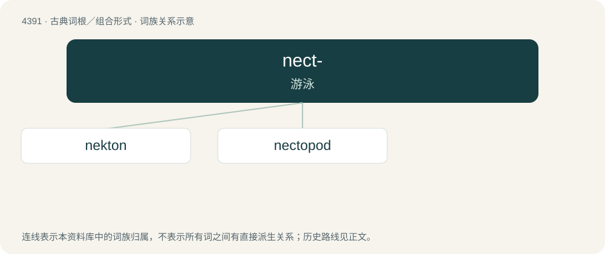

# 4391 · nect- — 游泳

[总目录](../00_总目录_按常用程度.md)

**类型**：古典词根／组合形式　｜　**来源语言**：古希腊语

## 核心含义与来源

- 核心含义：游泳
- 英文含义：swimming
- 词形：nect-

**来源词形**：νηκτός (nēktós)

## 词族图

## 单词速览（常用到不常用）

| 单词 | 音标 | 释义 |
|---|---|---|
| [nekton](#w-1) | /ˈnektən/ | n. 自泳动物 |
| [nectopod](#w-2) | /ˈnɛk.təˌpɒd/ | 游泳肢 |

## 逐词详解

### 1. nekton

**词性**：名词　｜　**音标**：/ˈnektən/

**中文释义**：n. 自泳动物

**英文义项**：All organisms in the ocean that are capable of swimming independently of currents.

**词源与演化**：

From German Nekton which was coined in 1890 by Ernst Haeckel. By surface analysis, Ancient Greek νηκτός (nēktós, “swimming”) + -on.

### 2. nectopod

**词性**：名词　｜　**音标**：/ˈnɛk.təˌpɒd/

**中文释义**：游泳肢

**英文义项**：A limb adapted for swimming in certain molluscs.

**词源与演化**：

From Ancient Greek νηκτός (nēktós, “swimming”) + -pod. By surface analysis, necto- + -pod.
