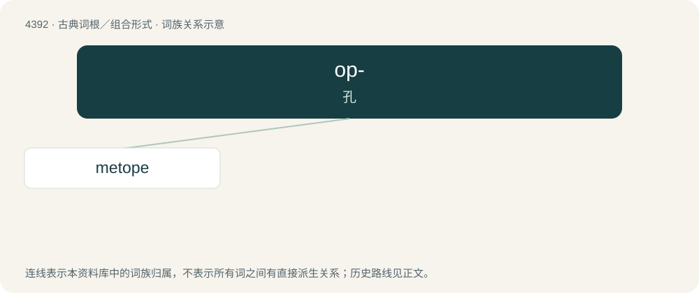

# 4392 · op- — 孔

[总目录](../00_总目录_按常用程度.md)

**类型**：古典词根／组合形式　｜　**来源语言**：古希腊语

## 核心含义与来源

- 核心含义：孔
- 英文含义：hole
- 词形：op-

**来源词形**：ὀπή (opḗ), ὀπαῖον (opaîon)

## 词族图

## 单词速览（常用到不常用）

| 单词 | 音标 | 释义 |
|---|---|---|
| [metope](#w-1) | /ˈmɛtəʊp/ | n. 三槽板间平面 |

## 逐词详解

### 1. metope

**词性**：名词　｜　**音标**：/ˈmɛtəʊp/

**中文释义**：n. 三槽板间平面

**英文义项**：The architectural element between two triglyphs in a Doric frieze.

**词源与演化**：

From Latin metopa and its source, Koine Greek μετόπη (metópē), from μετά (metá, “between”) + ὀπή (opḗ, “hole”).

## 其他候选词

- opaion
