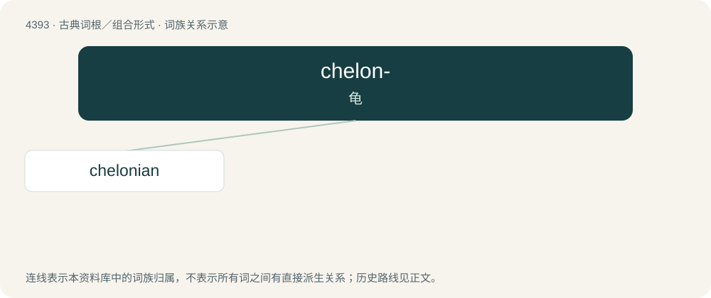

# 4393 · chelon- — 龟

[总目录](../00_总目录_按常用程度.md)

**类型**：古典词根／组合形式　｜　**来源语言**：古希腊语

## 核心含义与来源

- 核心含义：龟
- 英文含义：relating to a turtle
- 词形：chelon-

**来源词形**：χελώνη (khelṓnē) "tortoise"

## 词族图

## 单词速览（常用到不常用）

| 单词 | 音标 | 释义 |
|---|---|---|
| [chelonian](#w-1) | 英 /kɪˈləʊ.ni.ən/；美 /kɪˈloʊ.ni.ən/ | a. 海龟科的；n. 龟, 海龟 |

## 逐词详解

### 1. chelonian

**词性**：形容词　｜　**音标**：英 /kɪˈləʊ.ni.ən/；美 /kɪˈloʊ.ni.ən/

**中文释义**：a. 海龟科的；n. 龟, 海龟

**英文义项**：Of, relating to, or belonging to the order Chelonia (Testudines), which includes the turtles and tortoises.

**词源与演化**：

Chelonia + -an

## 其他候选词

- Archelon
- chelonia
