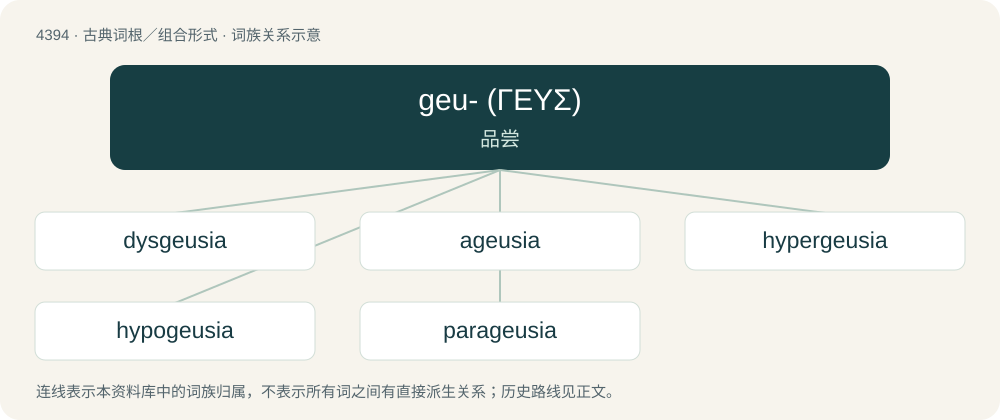

# 4394 · geu- (ΓΕΥΣ) — 品尝

[总目录](../00_总目录_按常用程度.md)

**类型**：古典词根／组合形式　｜　**来源语言**：古希腊语

## 核心含义与来源

- 核心含义：品尝
- 英文含义：taste
- 词形：geu-

**来源词形**：γεύειν (geúein), γεύεσθαι (geúesthai), γεῦσις, γευόμενον

## 词族图

## 单词速览（常用到不常用）

| 单词 | 音标 | 释义 |
|---|---|---|
| [dysgeusia](#w-1) | /dɪsˈɡuːʒə/ | \[医\] 味觉障碍 |
| [ageusia](#w-2) | /əˈɡjuːsi.ə/ | \[医\] 味觉缺失, 失味症 |
| [hypergeusia](#w-3) |  | \[医\] 味觉 |
| [hypogeusia](#w-4) | /,haipəˈ^juːsiə/ | n. \[医\]味觉减退, 味觉迟钝 |
| [parageusia](#w-5) | /,pærəˈ^juːʒiə/ | n. \[医\]味觉倒错, 味觉异常 |

## 逐词详解

### 1. dysgeusia

**词性**：名词　｜　**音标**：/dɪsˈɡuːʒə/

**中文释义**：\[医\] 味觉障碍

**英文义项**：The distortion or loss of the sense of taste; taste disorder.

**词源与演化**：

By surface analysis, dys- + Ancient Greek γεῦσις (geûsis, “taste”) + -ia.

### 2. ageusia

**词性**：名词　｜　**音标**：/əˈɡjuːsi.ə/

**中文释义**：\[医\] 味觉缺失, 失味症

**英文义项**：Absence of the sense of taste. / Partial or complete loss of the sense of taste.

**词源与演化**：

From a- (negative prefix) + Ancient Greek γεῦσις (geûsis, “taste”) + -ia. See also γεύω (geúō, “to taste”).

### 3. hypergeusia

**词性**：名词

**中文释义**：\[医\] 味觉

**英文义项**：A taste disorder in which the sense of taste is abnormally heightened

### 4. hypogeusia

**词性**：名词　｜　**音标**：/,haipəˈ^juːsiə/

**中文释义**：n. \[医\]味觉减退, 味觉迟钝

**英文义项**：Reduced sense of taste

### 5. parageusia

**词性**：名词　｜　**音标**：/,pærəˈ^juːʒiə/

**中文释义**：n. \[医\]味觉倒错, 味觉异常

**英文义项**：The abnormal presence of an unpleasant taste in the mouth, sometimes caused by medications.

**词源与演化**：

By surface analysis, para- + Ancient Greek γεῦσις (geûsis, “taste”) + -ia.
