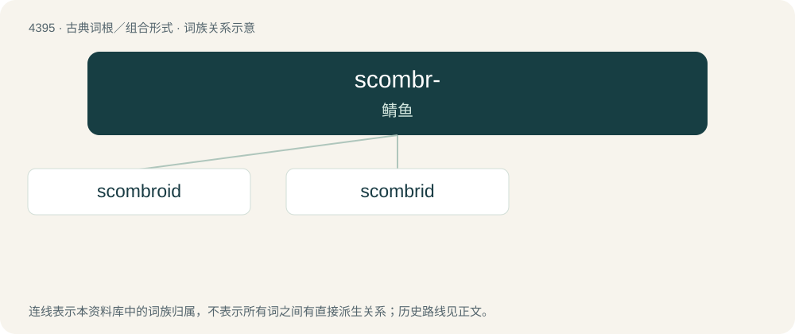

# 4395 · scombr- — 鲭鱼

[总目录](../00_总目录_按常用程度.md)

**类型**：古典词根／组合形式　｜　**来源语言**：古希腊语

## 核心含义与来源

- 核心含义：鲭鱼
- 英文含义：mackerel
- 词形：scombr-

**来源词形**：σκόμβρος (skómbros)

## 词族图

## 单词速览（常用到不常用）

| 单词 | 音标 | 释义 |
|---|---|---|
| [scombroid](#w-1) | /ˈskɒmbɹɔɪd/ | 鲭亚目鱼(的) |
| [scombrid](#w-2) | /ˈskɔmbrid/ | n. 鲭科鱼 |

## 逐词详解

### 1. scombroid

**词性**：形容词　｜　**音标**：/ˈskɒmbɹɔɪd/

**中文释义**：鲭亚目鱼(的)

**英文义项**：Pertaining to mackerel.

**词源与演化**：

From Ancient Greek σκόμβρος (skómbros, “tuna, mackerel”) + -oid.

### 2. scombrid

**词性**：名词　｜　**音标**：/ˈskɔmbrid/

**中文释义**：n. 鲭科鱼

**英文义项**：Any fish of the family Scombridae.
