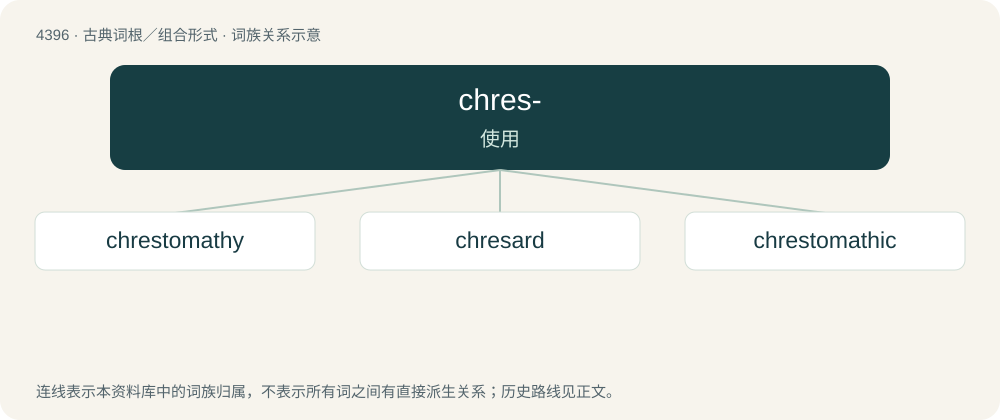

# 4396 · chres- — 使用

[总目录](../00_总目录_按常用程度.md)

**类型**：古典词根／组合形式　｜　**来源语言**：古希腊语

## 核心含义与来源

- 核心含义：使用
- 英文含义：use
- 词形：chres-

**来源词形**：χράω, χρῆσθαι (khrêsthai), χρηστός (khrēstós), χρήστης, χρῆσις (khrêsis), χρήσιμος

## 词族图

## 单词速览（常用到不常用）

| 单词 | 音标 | 释义 |
|---|---|---|
| [chrestomathy](#w-1) | /kɹɛˈstɒməθi/ | n. 诸家名文选集, 文摘 |
| [chresard](#w-2) | /ˈkɹiːˌsɑː(ɹ)d/ | n. (土壤中能被植物吸收的)有效水分,可用水量 |
| [chrestomathic](#w-3) | /ˌkɹɛstəˈmæθɪk/ | a. chrestomathy的变形 |

## 逐词详解

### 1. chrestomathy

**词性**：名词　｜　**音标**：/kɹɛˈstɒməθi/

**中文释义**：n. 诸家名文选集, 文摘

**英文义项**：A collection of written passages, used to learn an unfamiliar language. / A collection of choice passages from an author or authors.

**词源与演化**：

From New Latin chrēstomathia, from Ancient Greek χρηστομάθεια (khrēstomátheia, “desire for learning; book containing a summary of useful knowledge or select passages,”).

**用法示例／搭配（非完整句）**：

> EC Bridgman's Chinese Chrestomathy in the Canton Dialect (1841)

该用例对应义项：A collection of written passages, used to learn an unfamiliar language.

### 2. chresard

**词性**：名词　｜　**音标**：/ˈkɹiːˌsɑː(ɹ)d/

**中文释义**：n. (土壤中能被植物吸收的)有效水分,可用水量

**英文义项**：The portion of the water in a sample of soil that is available to vegetation (e.g. plant roots)

**词源与演化**：

From Ancient Greek χρῆσις (khrêsis, “use”) + ἄρδω (árdō, “to water, to irrigate”).

### 3. chrestomathic

**词性**：形容词　｜　**音标**：/ˌkɹɛstəˈmæθɪk/

**中文释义**：a. chrestomathy的变形

**英文义项**：That has a practical use

**构词拆分**：-ic + chrestomath + -ic

**词源与演化**：

From Ancient Greek χρηστομαθής (khrēstomathḗs, “adept in learning (useful things)”) + English -ic. By surface analysis, chrestomath + -ic.

## 其他候选词

- chresonym
- heterochresonym
- heterochresonymy
- orthochresonym
- orthochresonymy
