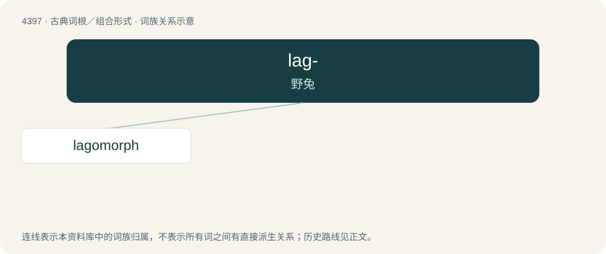

# 4397 · lag- — 野兔

[总目录](../00_总目录_按常用程度.md)

**类型**：古典词根／组合形式　｜　**来源语言**：古希腊语

## 核心含义与来源

- 核心含义：野兔
- 英文含义：hare
- 词形：lag-

**来源词形**：λαγός (lagós)

## 词族图

## 单词速览（常用到不常用）

| 单词 | 音标 | 释义 |
|---|---|---|
| [lagomorph](#w-1) | /ˈlægəmɒːf/ | n. 兔形目动物 |

## 逐词详解

### 1. lagomorph

**词性**：名词　｜　**音标**：/ˈlægəmɒːf/

**中文释义**：n. 兔形目动物

**英文义项**：A member of the mammalian taxonomic order Lagomorpha: a hare, a rabbit, or a pika. / A fursona that is a hare or rabbit.

**词源与演化**：

Borrowed from Translingual Lagomorpha.

## 其他候选词

- Sylvilagus
