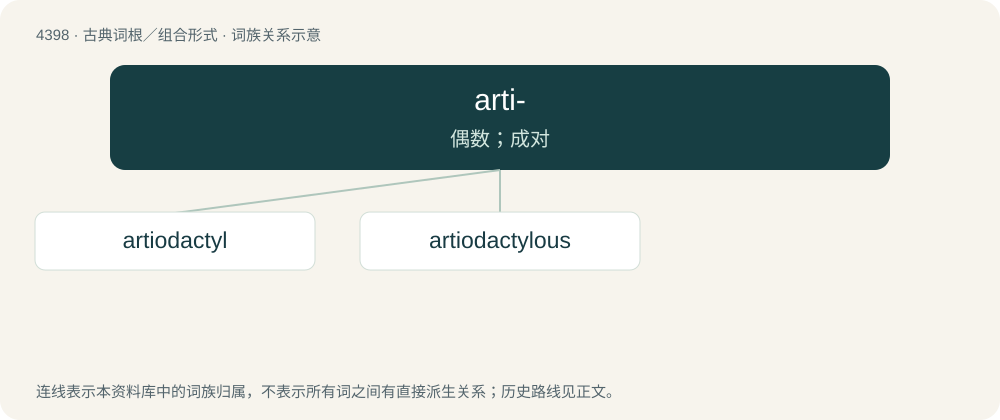

# 4398 · arti- — 偶数；成对

[总目录](../00_总目录_按常用程度.md)

**类型**：古典词根／组合形式　｜　**来源语言**：古希腊语

## 核心含义与来源

- 核心含义：偶数；成对
- 英文含义：even
- 词形：arti-

**来源词形**：ἄρτιος (ártios), ἀρτιότης "evenness", ἀρτιάκις

## 词族图

## 单词速览（常用到不常用）

| 单词 | 音标 | 释义 |
|---|---|---|
| [artiodactyl](#w-1) | 英 /ˌɑːtɪəʊˈdaktɪl/ | n. \[动\]偶蹄动物；a. 偶蹄动物的 |
| [artiodactylous](#w-2) |  | \[医\] 偶蹄类的 |

## 逐词详解

### 1. artiodactyl

**词性**：名词　｜　**音标**：英 /ˌɑːtɪəʊˈdaktɪl/

**中文释义**：n. \[动\]偶蹄动物；a. 偶蹄动物的

**英文义项**：Any ungulate mammal with an even number of toes and belonging to the Artiodactyla, including pigs, sheep, deer, cattle, and most grazing animals. In contrast, horses have an odd number of toes and as such are not Artiodactyla, but Perissodactyla.

**词源与演化**：

Learned borrowing from taxonomic name Artiodactyla, from Ancient Greek ἄρτιος (ártios, “even”) + δάκτυλος (dáktulos, “finger, toe”).

**例句**：

> The hippopotamus is the heaviest extant artiodactyl.

### 2. artiodactylous

**词性**：形容词

**中文释义**：\[医\] 偶蹄类的

**英文义项**：even-toed; belonging to the Artiodactyla
