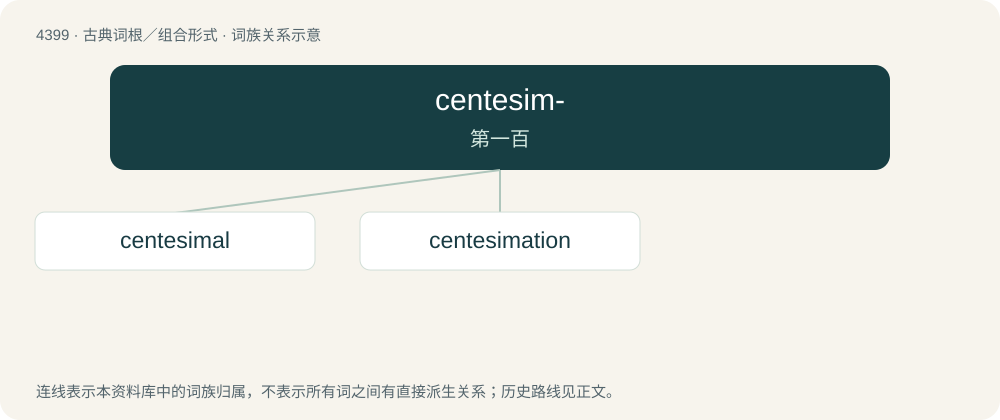

# 4399 · centesim- — 第一百

[总目录](../00_总目录_按常用程度.md)

**类型**：古典词根／组合形式　｜　**来源语言**：拉丁语

## 核心含义与来源

- 核心含义：第一百
- 英文含义：hundredth
- 词形：centesim-

**来源词形**：centesimus

## 词族图

## 单词速览（常用到不常用）

| 单词 | 音标 | 释义 |
|---|---|---|
| [centesimal](#w-1) | 美 /sɛnˈtɛsəməl/ | a. 百分之一的, 百分的, 百进位的；\[医\] 百分之一的, 分成百份的 |
| [centesimation](#w-2) | 英 /ˌsɛntiːsɪˈmeɪʃən/ | 【英文】The selection by lot of every hundredth man (of an army or group of prisoners or mutineers) for execution. |

## 逐词详解

### 1. centesimal

**词性**：形容词　｜　**音标**：美 /sɛnˈtɛsəməl/

**中文释义**：a. 百分之一的, 百分的, 百进位的；\[医\] 百分之一的, 分成百份的

**英文义项**：Divided into a hundred parts. / Describing a hundredth part.

**词源与演化**：

From Latin centēsimus + -al.

### 2. centesimation

**词性**：名词　｜　**音标**：英 /ˌsɛntiːsɪˈmeɪʃən/

**英文义项**：The selection by lot of every hundredth man (of an army or group of prisoners or mutineers) for execution.

**词源与演化**：

From the Latin centēsimātiō, from centēsimō, from centēsimus (“hundredth”); compare quintation, septimation, decimation, vicesimation, and tricesimation.
