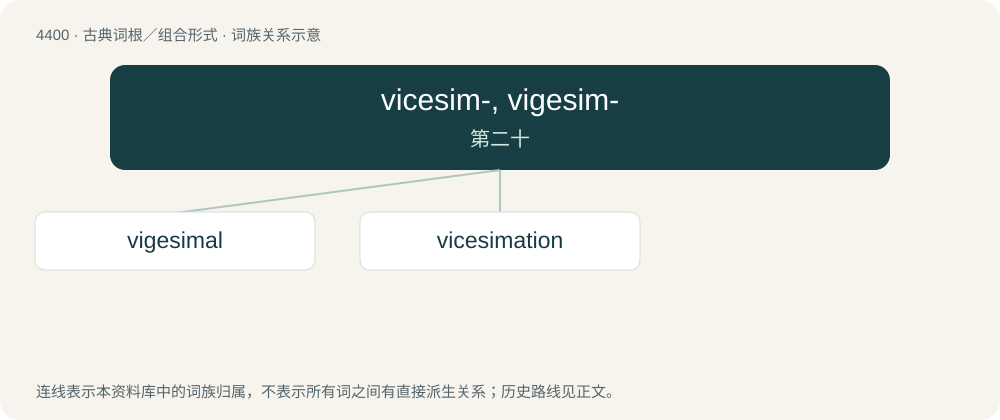

# 4400 · vicesim-, vigesim- — 第二十

[总目录](../00_总目录_按常用程度.md)

**类型**：古典词根／组合形式　｜　**来源语言**：拉丁语

## 核心含义与来源

- 核心含义：第二十
- 英文含义：twentieth
- 词形：vicesim-, vigesim-

**来源词形**：vicesimus

## 词族图

## 单词速览（常用到不常用）

| 单词 | 音标 | 释义 |
|---|---|---|
| [vigesimal](#w-1) | 英 /vɪˈd͡ʒɛsɪm(ə)l/ | a. 第二十的, 二十分之一的,以20为基数的 |
| [vicesimation](#w-2) | 英 /ˌvaɪsiːsɪˈmeɪʃən/ | 【英文】The destruction of one-twentieth of something; especially, the killing or putting to death of every twentieth person, especially by lot. |

## 逐词详解

### 1. vigesimal

**词性**：形容词　｜　**音标**：英 /vɪˈd͡ʒɛsɪm(ə)l/

**中文释义**：a. 第二十的, 二十分之一的,以20为基数的

**英文义项**：Occurring in intervals of twenty. / To the base twenty.

**词源与演化**：

From Latin vīgēsimus (“twentieth”), variant of Latin vīcēsimus (“twentieth”), from Latin vīgintī (“twenty”), (from \*vīcēnssos, from Proto-Indo-European \*wi(h₁)ḱm̥ttós, with the -imus ending of decimus (“tenth”)) + -al (suffix forming an adjective). Compare Latin vīgintī (“twenty”), from Proto-Indo-European \*h₁wih₁ḱm̥ti, from \*dwi(h₁)dḱm̥ti(h₁), \*dwi(h₁)dḱm̥ti (“two tens; two decades”).

### 2. vicesimation

**词性**：名词　｜　**音标**：英 /ˌvaɪsiːsɪˈmeɪʃən/

**英文义项**：The destruction of one-twentieth of something; especially, the killing or putting to death of every twentieth person, especially by lot.

**词源与演化**：

Probably formed by the suffixation of the Latin vīcēsimus (“twentieth”) with the English -ation on the pattern of decimation, but compare the Latin vīcēsimātiō (“a killing of every twentieth man”); the spelling vigesimation is an alteration of vicesimation under the influence of vigesimal.

## 其他候选词

- vicesimary
