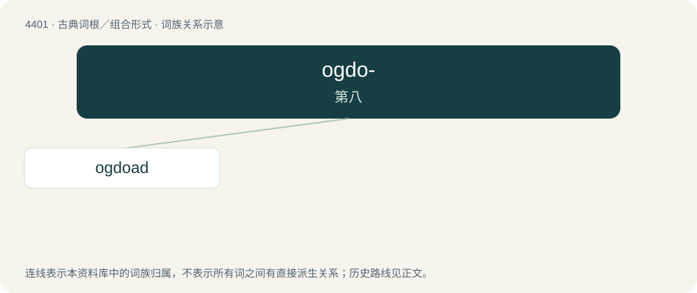

# 4401 · ogdo- — 第八

[总目录](../00_总目录_按常用程度.md)

**类型**：古典词根／组合形式　｜　**来源语言**：古希腊语

## 核心含义与来源

- 核心含义：第八
- 英文含义：eighth
- 词形：ogdo-

**来源词形**：ὄγδοος (ógdoos), ὀγδοάς, ὀγδοάδος (ogdoás, ogdoádos)

## 词族图

## 单词速览（常用到不常用）

| 单词 | 音标 | 释义 |
|---|---|---|
| [ogdoad](#w-1) | /ˈɒɡ.dəʊ.æd/ | 数目字八 |

## 逐词详解

### 1. ogdoad

**词性**：名词　｜　**音标**：/ˈɒɡ.dəʊ.æd/

**中文释义**：数目字八

**英文义项**：A thing made up of eight parts.

**词源与演化**：

From Ancient Greek ὀγδοάς (ogdoás, “eight, a group of eight”). By surface analysis, ogdo- + -ad.
