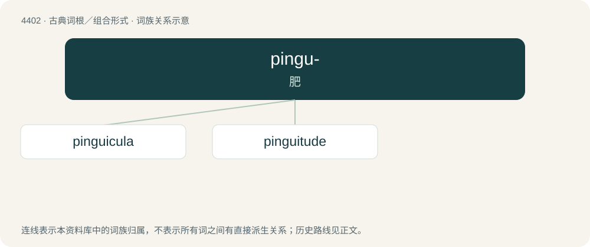

# 4402 · pingu- — 肥

[总目录](../00_总目录_按常用程度.md)

**类型**：古典词根／组合形式　｜　**来源语言**：拉丁语

## 核心含义与来源

- 核心含义：肥
- 英文含义：fat
- 词形：pingu-

**来源词形**：pinguis

## 词族图

## 单词速览（常用到不常用）

| 单词 | 音标 | 释义 |
|---|---|---|
| [pinguicula](#w-1) | /pɪŋˈɡaɪkjʊlə/ | \[医\]结膜黄斑, 睑裂黄斑 |
| [pinguitude](#w-2) |  | 【英文】fatness; obesity |

## 逐词详解

### 1. pinguicula

**词性**：名词　｜　**音标**：/pɪŋˈɡaɪkjʊlə/

**中文释义**：\[医\]结膜黄斑, 睑裂黄斑

**英文义项**：Any of the genus Pinguicula of butterworts.

**词源与演化**：

From the genus name translingual Pinguicula.

### 2. pinguitude

**词性**：名词

**英文义项**：fatness; obesity

**词源与演化**：

From Latin pinguitudo, from pinguis (“fat”).
