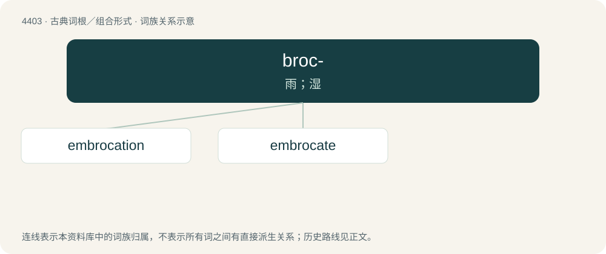

# 4403 · broc- — 雨；湿

[总目录](../00_总目录_按常用程度.md)

**类型**：古典词根／组合形式　｜　**来源语言**：古希腊语

## 核心含义与来源

- 核心含义：雨；湿
- 英文含义：rain, wet
- 词形：broc-

**来源词形**：ἐμβροχή (embrokhḗ)

## 词族图

## 单词速览（常用到不常用）

| 单词 | 音标 | 释义 |
|---|---|---|
| [embrocation](#w-1) | /embrouˈkeiʃən/ | n. 涂擦患处, 涂擦剂；\[化\] 搽剂 |
| [embrocate](#w-2) | /ˈembrəukeit/ | vt. 涂擦药液 |

## 逐词详解

### 1. embrocation

**词性**：名词　｜　**音标**：/embrouˈkeiʃən/

**中文释义**：n. 涂擦患处, 涂擦剂；\[化\] 搽剂

**英文义项**：The act of moistening and rubbing a diseased part with spirit, oil, etc. / The liquid or lotion with which an affected part is rubbed.

### 2. embrocate

**词性**：动词　｜　**音标**：/ˈembrəukeit/

**中文释义**：vt. 涂擦药液

**英文义项**：To rub (a diseased part) with a moistened or liquid substance, usually an oil, on a cloth or sponge.

**词源与演化**：

From Medieval Latin embrocatus, past participle of Late Latin embrocare, from embrocha, from Ancient Greek ἐμβροχή (embrokhḗ, “lotion, fomentation”).
