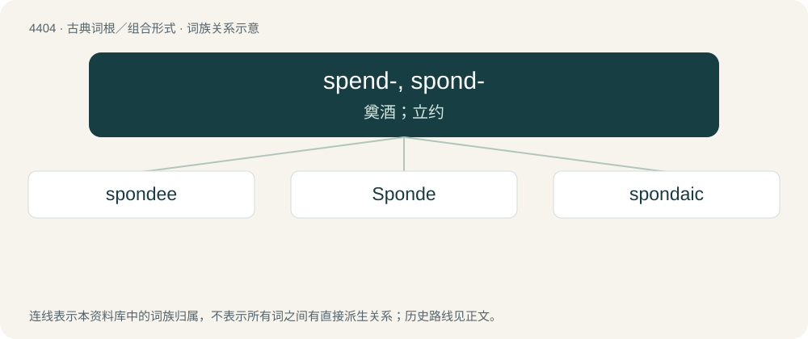

# 4404 · spend-, spond- — 奠酒；立约

[总目录](../00_总目录_按常用程度.md)

**类型**：古典词根／组合形式　｜　**来源语言**：古希腊语

## 核心含义与来源

- 核心含义：奠酒；立约
- 词形：spend-, spond-

**来源词形**：σπένδειν (spéndein), σπονδή, σπονδάς (spondḗ, spondás), σπονδεῖος, σπονδικός

## 词族图

## 单词速览（常用到不常用）

| 单词 | 音标 | 释义 |
|---|---|---|
| [spondee](#w-1) | /ˈspɒndi/ | n. 扬扬格 |
| [Sponde](#w-2) |  | 【英文】One of the moons of Jupiter. |
| [spondaic](#w-3) | /spɒnˈdeiik/ | a. 扬扬格的 |

## 逐词详解

### 1. spondee

**词性**：名词　｜　**音标**：/ˈspɒndi/

**中文释义**：n. 扬扬格

**英文义项**：A word or metrical foot of two syllables, either both long or both stressed.

**词源与演化**：

From Latin spondēus (“spondee”), from Ancient Greek σπονδεῖος (spondeîos, “associated with a libation”) from σπονδή (spondḗ, “libation”): spondees were often used in melodies sung at libations.

### 2. Sponde

**词性**：专有名词

**英文义项**：One of the moons of Jupiter.

### 3. spondaic

**词性**：形容词　｜　**音标**：/spɒnˈdeiik/

**中文释义**：a. 扬扬格的

**英文义项**：Having or relating to spondees.

**词源与演化**：

From Latin spondaicus, spondiacus, from Ancient Greek σπονδειακός (spondeiakós, “(music) used at a libation”).
