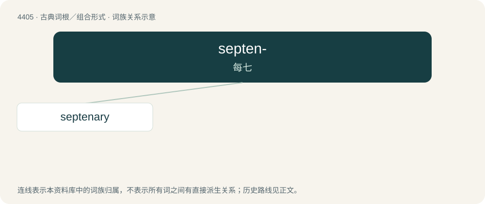

# 4405 · septen- — 每七

[总目录](../00_总目录_按常用程度.md)

**类型**：古典词根／组合形式　｜　**来源语言**：拉丁语

## 核心含义与来源

- 核心含义：每七
- 英文含义：seven each
- 词形：septen-

**来源词形**：septeni

## 词族图

## 单词速览（常用到不常用）

| 单词 | 音标 | 释义 |
|---|---|---|
| [septenary](#w-1) | 英 /sɛpˈtiːnəɹi/ | a. 七的, 每七年一次的, 为期七年的；n. 七, 七个一组, 七个一套, 为期七年；\[计\] 七进制的 |

## 逐词详解

### 1. septenary

**词性**：形容词　｜　**音标**：英 /sɛpˈtiːnəɹi/

**中文释义**：a. 七的, 每七年一次的, 为期七年的；n. 七, 七个一组, 七个一套, 为期七年；\[计\] 七进制的

**英文义项**：Consisting of or containing seven. / Of seventh rank or order.

**词源与演化**：

From Middle English septenarie, septenary, from Classical Latin septēnārius (“consisting of seven each”), from septēnus (“seven each; seven at a time”) + -ārius (whence the English suffix -ary). With use as noun compare septēnārius (“line of seven feet; unit of seven parts; period of seven years”). By surface analysis, septen- + -ary. Doublet of septenar and septenarius.
