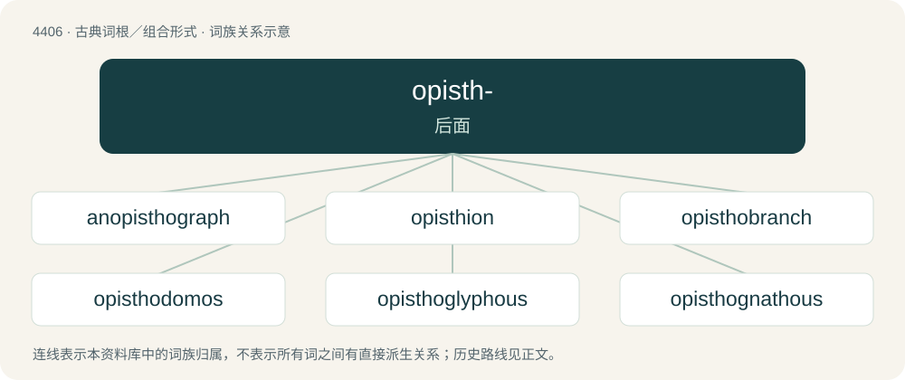

# 4406 · opisth- — 后面

[总目录](../00_总目录_按常用程度.md)

**类型**：古典词根／组合形式　｜　**来源语言**：古希腊语

## 核心含义与来源

- 核心含义：后面
- 英文含义：behind
- 词形：opisth-

**来源词形**：ὄπισθεν (ópisthen), ὀπίσθιος

## 词族图

## 单词速览（常用到不常用）

| 单词 | 音标 | 释义 |
|---|---|---|
| [anopisthograph](#w-1) | /,ænəˈpisə^rɑːf/ | n. 单面有字的书(手稿) |
| [opisthion](#w-2) | /əjˈpisθiən/ | n. \[解\]颅后点,枕骨 |
| [opisthobranch](#w-3) | /ɵˈpɪsθəbɹæŋk/ | \[动\]n.后鳃目软体动物 |
| [opisthodomos](#w-4) | /,ɔpisˈθɔdəməs/ | \[建\]后殿, (指寺庙等的)后室 |
| [opisthoglyphous](#w-5) |  | 【英文】Whose teeth include an enlarged pair at the back of the maxillae which normally angle backwards and are grooved to channel venom into the puncture. |
| [opisthognathous](#w-6) | /,ɔpisˈθɔ^nəθəs/ | \[动\]后口的, 后颚的 |
| [opisthograph](#w-7) | /əˈpisθə^rɑːf/ | n. (羊皮纸正反两面都写有文字的)古手稿本,(正反两面刻印有文字的)古字板 |
| [opisthokont](#w-8) | 英 /ɒˈpɪsθəʊ̆kɒnt/ | 【英文】Any of very many eukaryotes, including animals and fungi, whose flagellate cells (if any) propel themselves with a single posterior flagellum. |
| [opisthosoma](#w-9) |  | 末体 |
| [opsimath](#w-10) | 英 /ˈɒpsɪmæθ/；美 /ˈɑpsɪmæθ/ | n. 晚年开始学习的人 |
| [opsimathy](#w-11) | /ɒpˈsɪməθi/ | 晚学, 接受教育晚 |

## 逐词详解

### 1. anopisthograph

**词性**：形容词　｜　**音标**：/,ænəˈpisə^rɑːf/

**中文释义**：n. 单面有字的书(手稿)

**英文义项**：Written on one side only.

**构词拆分**：an- + opisthograph

**词源与演化**：

From an- + opisthograph.

### 2. opisthion

**词性**：名词　｜　**音标**：/əjˈpisθiən/

**中文释义**：n. \[解\]颅后点,枕骨

**英文义项**：The middle of the posterior margin of the foramen magnum of the skull.

**词源与演化**：

From New Latin opisthion, from Ancient Greek ὀπίσθιος (opísthios, “rear, behind”), from ὄπισθεν (ópisthen, “at the back, backwards”). By surface analysis, opisth- + -ion.

### 3. opisthobranch

**词性**：名词　｜　**音标**：/ɵˈpɪsθəbɹæŋk/

**中文释义**：\[动\]n.后鳃目软体动物

**英文义项**：A gastropod with gills behind the heart, formerly thought to belong to a single group.

**构词拆分**：opistho- + branchia

**词源与演化**：

From opistho- + branchia.

### 4. opisthodomos

**词性**：名词　｜　**音标**：/,ɔpisˈθɔdəməs/

**中文释义**：\[建\]后殿, (指寺庙等的)后室

**英文义项**：A porch at the rear of a temple, set against the blank back wall of the cella.

**词源与演化**：

Borrowed from Ancient Greek ὀπισθόδομος (opisthódomos, “back room”), from ὄπισθεν (ópisthen) + δόμος (dómos).

### 5. opisthoglyphous

**词性**：形容词

**英文义项**：Whose teeth include an enlarged pair at the back of the maxillae which normally angle backwards and are grooved to channel venom into the puncture.

**构词拆分**：opisthoglyph + -ous

**词源与演化**：

From opisthoglyph + -ous.

### 6. opisthognathous

**词性**：形容词　｜　**音标**：/,ɔpisˈθɔ^nəθəs/

**中文释义**：\[动\]后口的, 后颚的

**英文义项**：Having retreating jaws or teeth.

**构词拆分**：opistho- + -gnathous

**词源与演化**：

From opistho- + -gnathous.

### 7. opisthograph

**词性**：名词　｜　**音标**：/əˈpisθə^rɑːf/

**中文释义**：n. (羊皮纸正反两面都写有文字的)古手稿本,(正反两面刻印有文字的)古字板

**英文义项**：Any early document (such as a roll of papyrus) that has writing on the back as well as the front. / Any early book that has letterpress printing on both sides of the page.

**构词拆分**：opistho- + -graph

**词源与演化**：

From opistho- + -graph.

### 8. opisthokont

**词性**：名词　｜　**音标**：英 /ɒˈpɪsθəʊ̆kɒnt/

**英文义项**：Any of very many eukaryotes, including animals and fungi, whose flagellate cells (if any) propel themselves with a single posterior flagellum.

**构词拆分**：opistho- + -kont (“flagellate”)

**词源与演化**：

From opistho- + -kont (“flagellate”) from Ancient Greek κοντός (kontós, “pole”).

### 9. opisthosoma

**词性**：名词

**中文释义**：末体

**英文义项**：The posterior segment of the two-part body structure of chelicerates. Often used interchangeably with abdomen.

**构词拆分**：From opistho- + soma.

**词源与演化**：

From opistho- + soma.

### 10. opsimath

**词性**：名词　｜　**音标**：英 /ˈɒpsɪmæθ/；美 /ˈɑpsɪmæθ/

**中文释义**：n. 晚年开始学习的人

**英文义项**：A person who learns late in life.

**词源与演化**：

From the Ancient Greek ὀψιμαθής (opsimathḗs, “late in learning”), ultimately from ὀψέ (opsé, “late”) and μανθάνω (manthánō, “I learn”); compare opsimathy, philomath, and polymath. First appears c. 1808 in The Gentleman's Magazine.

### 11. opsimathy

**词性**：名词　｜　**音标**：/ɒpˈsɪməθi/

**中文释义**：晚学, 接受教育晚

**英文义项**：Learning or education that occurs late in life.

**构词拆分**：From opsimath + -y.

**词源与演化**：

From opsimath + -y.

**例句**：

> His opsimathy meant that he was over 60 before he entered college, and over 70 before he earned his doctorate.

该用例对应义项：Learning or education that occurs late in life.
