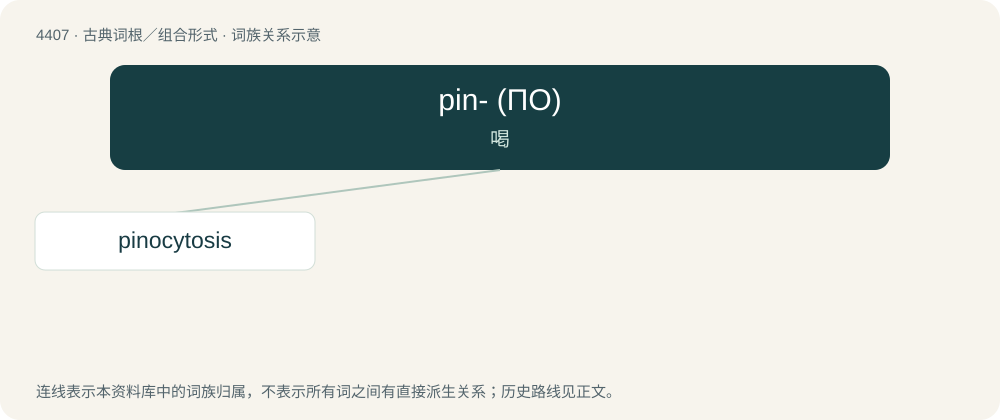

# 4407 · pin- (ΠΟ) — 喝

[总目录](../00_总目录_按常用程度.md)

**类型**：古典词根／组合形式　｜　**来源语言**：古希腊语

## 核心含义与来源

- 核心含义：喝
- 英文含义：drink
- 词形：pin-

**来源词形**：πίνειν (pínein), πῶμα

## 词族图

## 单词速览（常用到不常用）

| 单词 | 音标 | 释义 |
|---|---|---|
| [pinocytosis](#w-1) | /,painəusaiˈtəusis/ | n. \[生\]胞饮(作用),饮液(作用),吞饮(作用) |

## 逐词详解

### 1. pinocytosis

**词性**：名词　｜　**音标**：/,painəusaiˈtəusis/

**中文释义**：n. \[生\]胞饮(作用),饮液(作用),吞饮(作用)

**英文义项**：A form of endocytosis in which material enters a cell through its membrane and is incorporated in vesicles for digestion.

**词源与演化**：

From New Latin pīnocytōsis, from Ancient Greek πῑ́νω (pī́nō, “to drink”) + cyt- + -osis.
