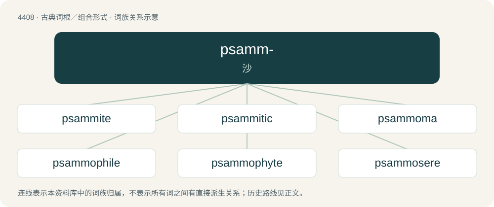

# 4408 · psamm- — 沙

[总目录](../00_总目录_按常用程度.md)

**类型**：古典词根／组合形式　｜　**来源语言**：古希腊语

## 核心含义与来源

- 核心含义：沙
- 英文含义：sand
- 词形：psamm-

**来源词形**：ψάμμος (psámmos), ψάμαθος (psámathos)

## 词族图

## 单词速览（常用到不常用）

| 单词 | 音标 | 释义 |
|---|---|---|
| [psammite](#w-1) | /ˈsæmait/ | n. \[地\]粗粒碎屑岩,砂屑岩 |
| [psammitic](#w-2) |  | 【英文】Of or relating to psammite. |
| [psammoma](#w-3) | /sæˈməumə/ | 沙瘤 |
| [psammophile](#w-4) | /ˈsæməfaɪl/ | n. 适沙生物,喜沙生物 |
| [psammophyte](#w-5) | /ˈsæməfait/ | n. \[植\]沙生植物 |
| [psammosere](#w-6) | /ˈsæməsɪə(ɹ)/ | 海滨演替系列, 沙生演替系列 |
| [psammous](#w-7) |  | \[医\] 沙的 |

## 逐词详解

### 1. psammite

**词性**：名词　｜　**音标**：/ˈsæmait/

**中文释义**：n. \[地\]粗粒碎屑岩,砂屑岩

**英文义项**：Any sandstone, but most often a metamorphosed rock unit with a dominantly sandstone protolith

**词源与演化**：

Ancient Greek ψάμμος (psámmos) + -ite

### 2. psammitic

**词性**：形容词

**英文义项**：Of or relating to psammite.

**构词拆分**：psammite + -ic

**词源与演化**：

From psammite + -ic.

### 3. psammoma

**词性**：名词　｜　**音标**：/sæˈməumə/

**中文释义**：沙瘤

**英文义项**：A brain tumour containing concretions resembling grains of sand

**构词拆分**：psammo- + -oma

**词源与演化**：

From psammo- + -oma.

### 4. psammophile

**词性**：名词　｜　**音标**：/ˈsæməfaɪl/

**中文释义**：n. 适沙生物,喜沙生物

**英文义项**：An arenophile, a sand-loving organism.

**构词拆分**：psammo- (“sand-”) + -phile

**词源与演化**：

From psammo- (“sand-”) + -phile.

### 5. psammophyte

**词性**：名词　｜　**音标**：/ˈsæməfait/

**中文释义**：n. \[植\]沙生植物

**英文义项**：Any plant which thrives in sandy conditions.

**词源与演化**：

From German Psammophyt, containing Ancient Greek ψάμμος (psámmos, “sand”). By surface analysis, psammo- + -phyte.

### 6. psammosere

**词性**：名词　｜　**音标**：/ˈsæməsɪə(ɹ)/

**中文释义**：海滨演替系列, 沙生演替系列

**英文义项**：A sere originating on coastal sand.

**构词拆分**：psammo- + sere

**词源与演化**：

From psammo- + sere.

### 7. psammous

**词性**：形容词

**中文释义**：\[医\] 沙的

**英文义项**：Of a sandy, gritty texture.

## 其他候选词

- Psammophis
