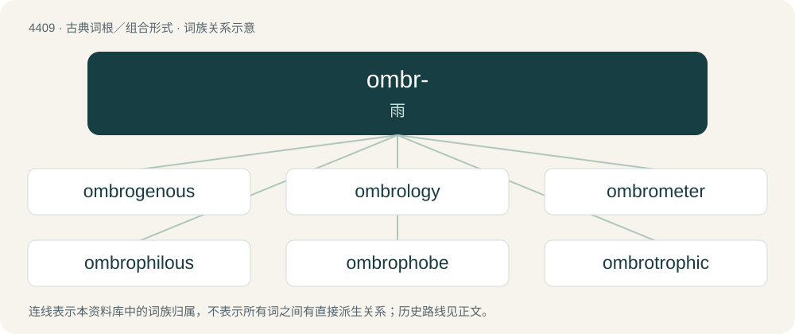

# 4409 · ombr- — 雨

[总目录](../00_总目录_按常用程度.md)

**类型**：古典词根／组合形式　｜　**来源语言**：古希腊语

## 核心含义与来源

- 核心含义：雨
- 英文含义：rain
- 词形：ombr-

**来源词形**：ὄμβρος (ómbros)

## 词族图

## 单词速览（常用到不常用）

| 单词 | 音标 | 释义 |
|---|---|---|
| [ombrogenous](#w-1) |  | 【英文】Dependant on rain. |
| [ombrology](#w-2) | /ɒmˈbrɒlədʒi/ | n. 测雨学 |
| [ombrometer](#w-3) | /ɔmˈbrɔmitə/ | n. 雨量计, 雨计 |
| [ombrophilous](#w-4) | /ˈɒmbəɒfələs/ | \[医\]喜雨的 |
| [ombrophobe](#w-5) |  | 避雨植物 |
| [ombrotrophic](#w-6) |  | 【英文】Pertaining to ombrotrophy. |

## 逐词详解

### 1. ombrogenous

**词性**：形容词

**英文义项**：Dependant on rain.

**构词拆分**：ombro- + -genous

**词源与演化**：

ombro- + -genous

### 2. ombrology

**词性**：名词　｜　**音标**：/ɒmˈbrɒlədʒi/

**中文释义**：n. 测雨学

**英文义项**：The study of rainfall.

### 3. ombrometer

**词性**：名词　｜　**音标**：/ɔmˈbrɔmitə/

**中文释义**：n. 雨量计, 雨计

**英文义项**：A rain gauge

**构词拆分**：ombro- + -meter

**词源与演化**：

From ombro- + -meter.

### 4. ombrophilous

**词性**：形容词　｜　**音标**：/ˈɒmbəɒfələs/

**中文释义**：\[医\]喜雨的

**英文义项**：Capable of thriving in areas of heavy rainfall

**构词拆分**：ombro- + -philous

**词源与演化**：

From ombro- + -philous.

### 5. ombrophobe

**词性**：形容词

**中文释义**：避雨植物

**英文义项**：Synonym of ombrophobic.

### 6. ombrotrophic

**词性**：形容词

**英文义项**：Pertaining to ombrotrophy.

**构词拆分**：ombro- + -trophic

**词源与演化**：

From ombro- + -trophic.

## 其他候选词

- Ombrophila
