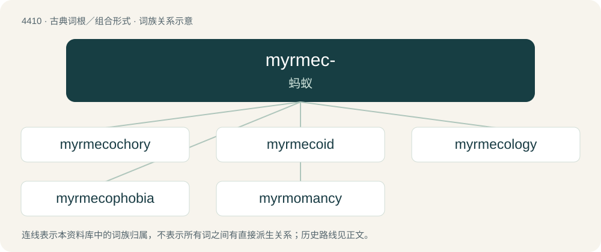

# 4410 · myrmec- — 蚂蚁

[总目录](../00_总目录_按常用程度.md)

**类型**：古典词根／组合形式　｜　**来源语言**：古希腊语

## 核心含义与来源

- 核心含义：蚂蚁
- 英文含义：ant
- 词形：myrmec-

**来源词形**：μύρμηξ (múrmēx)

## 词族图

## 单词速览（常用到不常用）

| 单词 | 音标 | 释义 |
|---|---|---|
| [myrmecochory](#w-1) |  | 蚁布 |
| [myrmecoid](#w-2) |  | 【英文】ant-like |
| [myrmecology](#w-3) | /ˌmɜː(ɹ)mɪˈkɒləd͡ʒi/ | n. \[昆\]蚁类研究,蚁学 |
| [myrmecophobia](#w-4) |  | 【英文】The fear of ants. |
| [myrmomancy](#w-5) |  | 【英文】Divination by interpreting the appearance and behaviour of ants, especially their eating habits. A type of augury. |

## 逐词详解

### 1. myrmecochory

**词性**：名词

**中文释义**：蚁布

**英文义项**：The dispersal of seeds, spores, or fruit by ants.

**构词拆分**：myrmeco- + -chory

**词源与演化**：

From myrmeco- + -chory.

### 2. myrmecoid

**词性**：形容词

**英文义项**：ant-like

**构词拆分**：myrmeco- + -oid

**词源与演化**：

From myrmeco- + -oid.

### 3. myrmecology

**词性**：名词　｜　**音标**：/ˌmɜː(ɹ)mɪˈkɒləd͡ʒi/

**中文释义**：n. \[昆\]蚁类研究,蚁学

**英文义项**：The study of ants.

**构词拆分**：myrmeco- (“ant”) + -logy (“study (of)”)

**词源与演化**：

From Ancient Greek myrmeco- (“ant”) + -logy (“study (of)”).

**例句**：

> It seems that Ali is very interested in Myrmecology.

### 4. myrmecophobia

**词性**：名词

**英文义项**：The fear of ants.

**构词拆分**：myrmeco- + -phobia

**词源与演化**：

From myrmeco- + -phobia.

### 5. myrmomancy

**词性**：名词

**英文义项**：Divination by interpreting the appearance and behaviour of ants, especially their eating habits. A type of augury.

**词源与演化**：

From Ancient Greek μύρμηξ (múrmēx, “ants”) + English -mancy.

## 其他候选词

- Myrmidons
