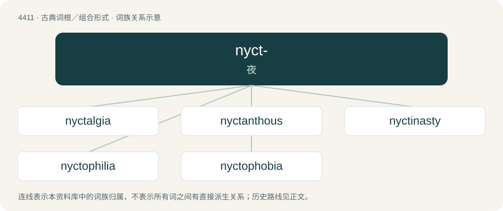

# 4411 · nyct- — 夜

[总目录](../00_总目录_按常用程度.md)

**类型**：古典词根／组合形式　｜　**来源语言**：古希腊语

## 核心含义与来源

- 核心含义：夜
- 英文含义：night
- 词形：nyct-

**来源词形**：νύξ, νυκτός (núx, nuktós)

## 词族图

## 单词速览（常用到不常用）

| 单词 | 音标 | 释义 |
|---|---|---|
| [nyctalgia](#w-1) | /nikˈtældʒiə/ | n. \[医\] 夜痛 |
| [nyctanthous](#w-2) | /nikˈtænθəs/ | a. 夜开的 |
| [nyctinasty](#w-3) | /,niktiˈnæsti/ | n. \[植\]感夜性,就眠性 |
| [nyctophilia](#w-4) | /,niktəˈfiliə/ | 嗜夜癖 |
| [nyctophobia](#w-5) | /.niktəˈfəubiə/ | n. 黑夜恐怖症；\[医\] 黑夜恐怖 |

## 逐词详解

### 1. nyctalgia

**词性**：名词　｜　**音标**：/nikˈtældʒiə/

**中文释义**：n. \[医\] 夜痛

**英文义项**：pain that occurs only at night, especially pain associated with the bones due to syphilis

**构词拆分**：nyct- + -algia

**词源与演化**：

From nyct- + -algia.

### 2. nyctanthous

**词性**：形容词　｜　**音标**：/nikˈtænθəs/

**中文释义**：a. 夜开的

**英文义项**：Flowering at night.

### 3. nyctinasty

**词性**：名词　｜　**音标**：/,niktiˈnæsti/

**中文释义**：n. \[植\]感夜性,就眠性

**英文义项**：The movement of leaves or petals in response to darkness; the closing of a flower at night.

**构词拆分**：nycti- + -nasty

**词源与演化**：

From nycti- + -nasty. By surface analysis, nycti- + -nast + -y.

### 4. nyctophilia

**词性**：名词　｜　**音标**：/,niktəˈfiliə/

**中文释义**：嗜夜癖

**英文义项**：Love of the night; attraction (sometimes sexual) to night or darkness.

**构词拆分**：nycto- + -philia

**词源与演化**：

From nycto- (“night”) + -philia.

### 5. nyctophobia

**词性**：名词　｜　**音标**：/.niktəˈfəubiə/

**中文释义**：n. 黑夜恐怖症；\[医\] 黑夜恐怖

**英文义项**：A fear of the night, nighttime, or darkness.

**构词拆分**：nycto- + -phobia

**词源与演化**：

From nycto- + -phobia.
