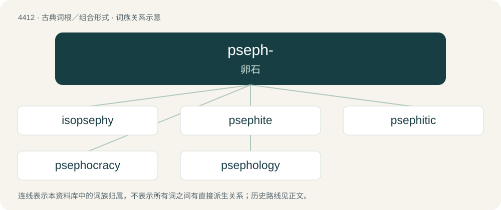

# 4412 · pseph- — 卵石

[总目录](../00_总目录_按常用程度.md)

**类型**：古典词根／组合形式　｜　**来源语言**：古希腊语

## 核心含义与来源

- 核心含义：卵石
- 英文含义：pebble
- 词形：pseph-

**来源词形**：ψάω, ψῆφος (psêphos), ψηφίζειν (psēphízein)

## 词族图

## 单词速览（常用到不常用）

| 单词 | 音标 | 释义 |
|---|---|---|
| [isopsephy](#w-1) | /ˈaɪsəpˌsɛfi/ | 【英文】The practice of adding up the numerical values of the letters in a word to form a single number. |
| [psephite](#w-2) | /ˈsiːfait/ | n. \[地\]碎砾岩,砾质岩,砾状岩 |
| [psephitic](#w-3) |  | 砾状 |
| [psephocracy](#w-4) | 英 /psɪˈfɒkɹəsi/；美 /psiˈfɑkɹəsi/ | 选举政治 |
| [psephology](#w-5) | 英 /sɪˈfɒl.ə.d͡ʒi/；美 /sɪˈfɑl.ə.d͡ʒi/ | n. 选举学；\[法\] 选举学 |

## 逐词详解

### 1. isopsephy

**词性**：名词　｜　**音标**：/ˈaɪsəpˌsɛfi/

**英文义项**：The practice of adding up the numerical values of the letters in a word to form a single number.

**词源与演化**：

From Koine Greek ἰσοψηφία (isopsēphía), from ἴσος (ísos, “equal”) and ψῆφος (psêphos, “pebble”). The early Greeks used pebbles arranged in patterns to learn arithmetic and geometry.

### 2. psephite

**词性**：名词　｜　**音标**：/ˈsiːfait/

**中文释义**：n. \[地\]碎砾岩,砾质岩,砾状岩

**英文义项**：A sediment or sedimentary rock composed of fragments that are coarser than sand and which are enclosed in a matrix that varies in kind and amount.

**词源与演化**：

From Ancient Greek ψῆφος (psêphos, “pebble”) + -ite.

### 3. psephitic

**词性**：形容词

**中文释义**：砾状

**英文义项**：Of or relating to psephite.

**构词拆分**：psephite + -ic

**词源与演化**：

From psephite + -ic.

### 4. psephocracy

**词性**：名词　｜　**音标**：英 /psɪˈfɒkɹəsi/；美 /psiˈfɑkɹəsi/

**中文释义**：选举政治

**英文义项**：Government by ballot-elected representatives; representative democracy. Often contrasted with democracy, with which it is unfavourably compared for its lack of demotic participation in the political process outside of elections.

**构词拆分**：pseph- + -o- + -cracy

**词源与演化**：

From pseph- + -o- + -cracy.

### 5. psephology

**词性**：名词　｜　**音标**：英 /sɪˈfɒl.ə.d͡ʒi/；美 /sɪˈfɑl.ə.d͡ʒi/

**中文释义**：n. 选举学；\[法\] 选举学

**英文义项**：The predictive or statistical study of elections. / An ancient Greek method of numerology, similar to gematria.

**构词拆分**：psepho- (“pebble”) + -ology (“study of”)

**词源与演化**：

From psepho- (“pebble”) + -ology (“study of”), drawing on the various definitions of Ancient Greek ψῆφος (psêphos, “pebble used for reckoning; pebble used for casting a vote”). The sense relating to elections was coined in 1948 by Frank Hardie.
