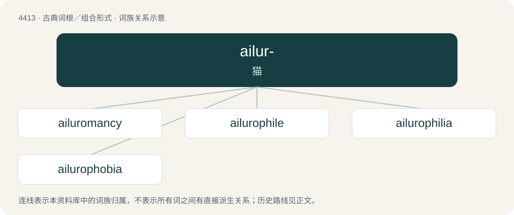

# 4413 · ailur- — 猫

[总目录](../00_总目录_按常用程度.md)

**类型**：古典词根／组合形式　｜　**来源语言**：古希腊语

## 核心含义与来源

- 核心含义：猫
- 英文含义：cat
- 词形：ailur-

**来源词形**：αἴλουρος (aílouros)

## 词族图

## 单词速览（常用到不常用）

| 单词 | 音标 | 释义 |
|---|---|---|
| [ailuromancy](#w-1) |  | 【英文】Divination by the appearance and behaviour of cats. |
| [ailurophile](#w-2) | 英 /aɪˈljʊəɹəˌfaɪl/ | n. 极其喜爱猫的人,养猫的行家 |
| [ailurophilia](#w-3) | 英 /ˌaɪljʊəɹəˈfɪlɪ.ə/；美 /aɪˌlʊɹəˈfɪli.ə/ | n. 爱猫癖 |
| [ailurophobia](#w-4) | 英 /ˌaɪljʊəɹəˈfəʊbɪ.ə/；美 /aɪˌlʊɹəˈfoʊbi.ə/ | n. 惧猫症,对猫的极度厌恶 |

## 逐词详解

### 1. ailuromancy

**词性**：名词

**英文义项**：Divination by the appearance and behaviour of cats.

**构词拆分**：ailuro- + -mancy

**词源与演化**：

From ailuro- + -mancy.

### 2. ailurophile

**词性**：名词　｜　**音标**：英 /aɪˈljʊəɹəˌfaɪl/

**中文释义**：n. 极其喜爱猫的人,养猫的行家

**英文义项**：A person with ailurophilia; a cat-lover.

**构词拆分**：ailuro- (“cat”) + -phile (“lover”)

**词源与演化**：

From ailuro- (“cat”) + -phile (“lover”), from Ancient Greek αἴλουρος (aílouros, “cat”) + φίλος (phílos, “dear, beloved”).

### 3. ailurophilia

**词性**：名词　｜　**音标**：英 /ˌaɪljʊəɹəˈfɪlɪ.ə/；美 /aɪˌlʊɹəˈfɪli.ə/

**中文释义**：n. 爱猫癖

**英文义项**：A fondness or love for cats or other felines.

**构词拆分**：ailuro- (“cat”) + -philia (“love”)

**词源与演化**：

From ailuro- (“cat”) + -philia (“love”), from Ancient Greek αἴλουρος (aílouros, “cat”) + φίλος (phílos, “dear, beloved”).

### 4. ailurophobia

**词性**：名词　｜　**音标**：英 /ˌaɪljʊəɹəˈfəʊbɪ.ə/；美 /aɪˌlʊɹəˈfoʊbi.ə/

**中文释义**：n. 惧猫症,对猫的极度厌恶

**英文义项**：An irrational fear or hatred of cats or other felines.

**构词拆分**：ailuro- (“cat”) + -phobia (“fear, hatred”)

**词源与演化**：

First recorded in 1905. From ailuro- (“cat”) + -phobia (“fear, hatred”), both from Ancient Greek.

## 其他候选词

- Ailuroedus
