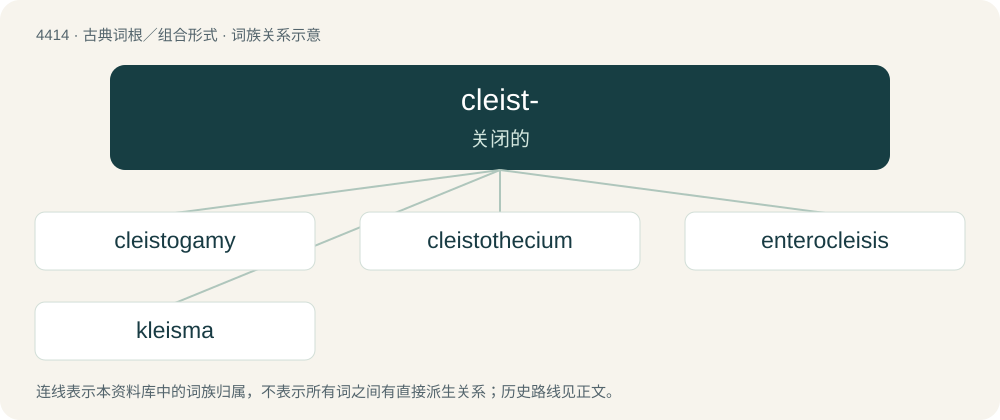

# 4414 · cleist- — 关闭的

[总目录](../00_总目录_按常用程度.md)

**类型**：古典词根／组合形式　｜　**来源语言**：古希腊语

## 核心含义与来源

- 核心含义：关闭的
- 英文含义：closed
- 词形：cleist-

**来源词形**：κλείειν, κλειστός (kleistós), κλεῖσμα

## 词族图

## 单词速览（常用到不常用）

| 单词 | 音标 | 释义 |
|---|---|---|
| [cleistogamy](#w-1) | /klaiˈstɒgəmi/ | n. 闭花受精 |
| [cleistothecium](#w-2) | /,klaistəˈθiːsiəm/ | (pl. -cia) 闭囊壳 |
| [enterocleisis](#w-3) |  | \[医\] 肠缝合, 肠闭塞 |
| [kleisma](#w-4) | /ˈklaɪzmə/ | 【英文】A very small interval that is the difference between 6 just minor thirds and a perfect twelfth. |

## 逐词详解

### 1. cleistogamy

**词性**：名词　｜　**音标**：/klaiˈstɒgəmi/

**中文释义**：n. 闭花受精

**英文义项**：The production of flowers which do not open and are self-fertilized in the bud.

**词源与演化**：

From Ancient Greek κλειστός (kleistós, “closed”) + -gamy.

### 2. cleistothecium

**词性**：名词　｜　**音标**：/,klaistəˈθiːsiəm/

**中文释义**：(pl. -cia) 闭囊壳

**英文义项**：A closed ascocarp, in some fungi, from which spores are released following decay or disintegration

**词源与演化**：

From Ancient Greek κλειστός (kleistós, “closed”) + thecium.

### 3. enterocleisis

**词性**：名词

**中文释义**：\[医\] 肠缝合, 肠闭塞

**英文义项**：Blockage of the intestines.

**词源与演化**：

From Ancient Greek ἔντερον (énteron, “intestine”) + Ancient Greek κλεῖσις (kleîsis). By surface analysis, entero- + -cleisis.

### 4. kleisma

**词性**：名词　｜　**音标**：/ˈklaɪzmə/

**英文义项**：A very small interval that is the difference between 6 just minor thirds and a perfect twelfth.

**词源与演化**：

From Ancient Greek κλεισμένος (kleisménos, “closed”).
