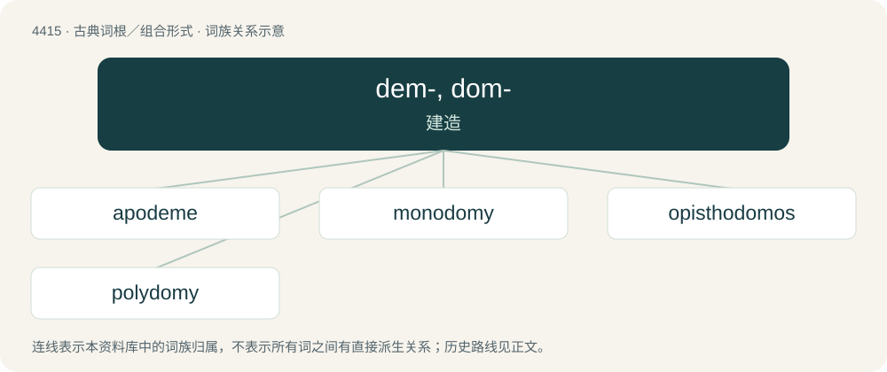

# 4415 · dem-, dom- — 建造

[总目录](../00_总目录_按常用程度.md)

**类型**：古典词根／组合形式　｜　**来源语言**：古希腊语

## 核心含义与来源

- 核心含义：建造
- 英文含义：build
- 词形：dem-, dom-

**来源词形**：δέμειν (démein), δῶμα, δῶματος, δομή, δόμος (dómos), δέμας (démas)

## 词族图

## 单词速览（常用到不常用）

| 单词 | 音标 | 释义 |
|---|---|---|
| [apodeme](#w-1) | /ˈæpə,diːm/ | \[动\]表皮内突 |
| [monodomy](#w-2) |  | 【英文】The situation where an ant colony is established at a single nest site. |
| [opisthodomos](#w-3) | /,ɔpisˈθɔdəməs/ | \[建\]后殿, (指寺庙等的)后室 |
| [polydomy](#w-4) |  | 【英文】The situation where an ant colony is established across multiple nest sites. |

## 逐词详解

### 1. apodeme

**词性**：名词　｜　**音标**：/ˈæpə,diːm/

**中文释义**：\[动\]表皮内突

**英文义项**：An ingrowth of the arthropod exoskeleton, serving as an attachment site for muscles.

### 2. monodomy

**词性**：名词

**英文义项**：The situation where an ant colony is established at a single nest site.

**词源与演化**：

From mono- + Ancient Greek δόμος (dómos, “house”) + -y.

### 3. opisthodomos

**词性**：名词　｜　**音标**：/,ɔpisˈθɔdəməs/

**中文释义**：\[建\]后殿, (指寺庙等的)后室

**英文义项**：A porch at the rear of a temple, set against the blank back wall of the cella.

**词源与演化**：

Borrowed from Ancient Greek ὀπισθόδομος (opisthódomos, “back room”), from ὄπισθεν (ópisthen) + δόμος (dómos).

### 4. polydomy

**词性**：名词

**英文义项**：The situation where an ant colony is established across multiple nest sites.

**词源与演化**：

From poly- + Ancient Greek δόμος (dómos, “house”) + -y.
