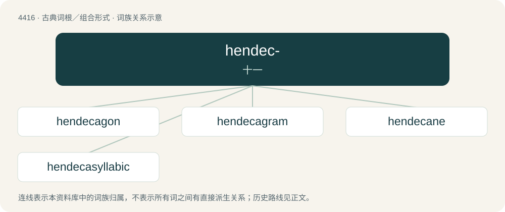

# 4416 · hendec- — 十一

[总目录](../00_总目录_按常用程度.md)

**类型**：古典词根／组合形式　｜　**来源语言**：古希腊语

## 核心含义与来源

- 核心含义：十一
- 英文含义：eleven
- 词形：hendec-

**来源词形**：ἕνδεκα (héndeka)

## 词族图

## 单词速览（常用到不常用）

| 单词 | 音标 | 释义 |
|---|---|---|
| [hendecagon](#w-1) | 英 /hɛnˈdɛkəɡən/；美 /hɛnˈdɛkəˌɡɑn/ | n. 十一边形, 十一角形 |
| [hendecagram](#w-2) |  | 【英文】A star polygon that has eleven vertices |
| [hendecane](#w-3) | /ˈhendə,kein/ | 十一(碳)烷 |
| [hendecasyllabic](#w-4) | 英 /hɛnˌdɛk.ə.sɪˈlæb.ɪk/；美 /hɛnˌdɛk.ə.sɪˈlæb.ɪk/ | n. 十一音节的一行诗；a. 包含有十一音节的 |

## 逐词详解

### 1. hendecagon

**词性**：名词　｜　**音标**：英 /hɛnˈdɛkəɡən/；美 /hɛnˈdɛkəˌɡɑn/

**中文释义**：n. 十一边形, 十一角形

**英文义项**：A polygon with eleven edges and eleven angles.

**构词拆分**：hendeca- + -gon

**词源与演化**：

From hendeca- + -gon.

### 2. hendecagram

**词性**：名词

**英文义项**：A star polygon that has eleven vertices

**构词拆分**：hendeca- + -gram

**词源与演化**：

From hendeca- + -gram.

### 3. hendecane

**词性**：名词　｜　**音标**：/ˈhendə,kein/

**中文释义**：十一(碳)烷

**英文义项**：Any saturated aliphatic hydrocarbon, C₁₁H₂₄, having eleven carbon atoms.

**词源与演化**：

From Ancient Greek ἕνδεκα (héndeka, “eleven”), from the number of carbon atoms in each molecule.

### 4. hendecasyllabic

**词性**：形容词　｜　**音标**：英 /hɛnˌdɛk.ə.sɪˈlæb.ɪk/；美 /hɛnˌdɛk.ə.sɪˈlæb.ɪk/

**中文释义**：n. 十一音节的一行诗；a. 包含有十一音节的

**英文义项**：Having eleven syllables.

**词源与演化**：

Borrowed from Latin hendecasyllabus, from Ancient Greek ἑνδεκασύλλαβος (hendekasúllabos), from ἕνδεκα (héndeka, “eleven”) + συλλαβή (sullabḗ, “syllable”).

## 其他候选词

- hendecagrammic
- hendecasyllable hendecahedron
