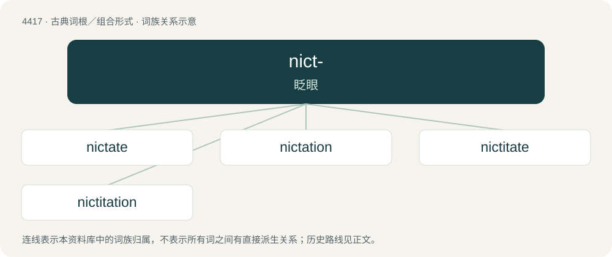

# 4417 · nict- — 眨眼

[总目录](../00_总目录_按常用程度.md)

**类型**：古典词根／组合形式　｜　**来源语言**：拉丁语

## 核心含义与来源

- 核心含义：眨眼
- 英文含义：beckon, wink
- 词形：nict-

**来源词形**：nictari

## 词族图

## 单词速览（常用到不常用）

| 单词 | 音标 | 释义 |
|---|---|---|
| [nictate](#w-1) | 英 /nɪkˈteɪt/ | vi.(鸟,哺乳动物等)眨眼, 瞬目 |
| [nictation](#w-2) | /nɪˈkteɪʃən/ | n. 眨眼睛, 瞬目 |
| [nictitate](#w-3) | /ˈnɪktɪteɪ̯t/ | vi. 眨眼；\[医\] 瞬眼 |
| [nictitation](#w-4) | /nɪktɪˈteɪʃən/ | \[医\] 瞬眼(眨眼) |

## 逐词详解

### 1. nictate

**词性**：动词　｜　**音标**：英 /nɪkˈteɪt/

**中文释义**：vi.(鸟,哺乳动物等)眨眼, 瞬目

**英文义项**：To wink or blink; (of certain animals) to close the nictating membrane.

**词源与演化**：

First attested in 1755; borrowed from Latin nictātus, perfect passive participle of nictō (“to wink, blink”), see -ate (verb-forming suffix).

### 2. nictation

**词性**：名词　｜　**音标**：/nɪˈkteɪʃən/

**中文释义**：n. 眨眼睛, 瞬目

**英文义项**：An act or instance of winking or blinking; a wink, a blink.

**词源与演化**：

From nictate.

### 3. nictitate

**词性**：动词　｜　**音标**：/ˈnɪktɪteɪ̯t/

**中文释义**：vi. 眨眼；\[医\] 瞬眼

**英文义项**：to wink or blink

**词源与演化**：

Back-formation from nictitating.

### 4. nictitation

**词性**：名词　｜　**音标**：/nɪktɪˈteɪʃən/

**中文释义**：\[医\] 瞬眼(眨眼)

**英文义项**：Winking, blinking

**词源与演化**：

From nictitate.
