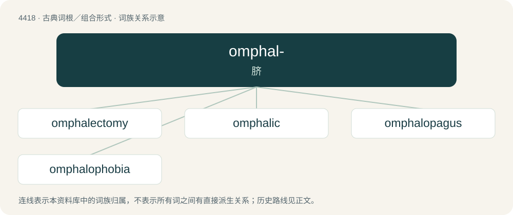

# 4418 · omphal- — 脐

[总目录](../00_总目录_按常用程度.md)

**类型**：古典词根／组合形式　｜　**来源语言**：古希腊语

## 核心含义与来源

- 核心含义：脐
- 英文含义：navel
- 词形：omphal-

**来源词形**：ὀμφαλός (omphalós)

## 词族图

## 单词速览（常用到不常用）

| 单词 | 音标 | 释义 |
|---|---|---|
| [omphalectomy](#w-1) |  | \[医\] 脐切除术 |
| [omphalic](#w-2) |  | \[医\] 脐的 |
| [omphalopagus](#w-3) |  | \[医\] 脐部联胎 |
| [omphalophobia](#w-4) |  | 【英文】Fear of navels. |

## 逐词详解

### 1. omphalectomy

**词性**：名词

**中文释义**：\[医\] 脐切除术

**英文义项**：The excision of the navel.

**构词拆分**：omphal- + -ectomy

**词源与演化**：

From omphal- + -ectomy.

### 2. omphalic

**词性**：形容词

**中文释义**：\[医\] 脐的

**英文义项**：Of or pertaining to the umbilicus, or navel.

### 3. omphalopagus

**词性**：名词

**中文释义**：\[医\] 脐部联胎

**英文义项**：Joined at the umbilicus.

**构词拆分**：omphalo- + -pagus

**词源与演化**：

From omphalo- + -pagus.

### 4. omphalophobia

**词性**：名词

**英文义项**：Fear of navels.

**构词拆分**：omphalo- + -phobia

**词源与演化**：

From omphalo- + -phobia.

## 其他候选词

- paromphalocele
