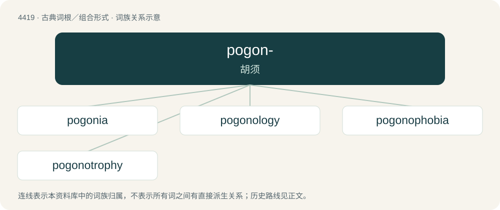

# 4419 · pogon- — 胡须

[总目录](../00_总目录_按常用程度.md)

**类型**：古典词根／组合形式　｜　**来源语言**：古希腊语

## 核心含义与来源

- 核心含义：胡须
- 英文含义：beard
- 词形：pogon-

**来源词形**：πώγων, πώγωνος (pṓgōn, pṓgōnos), πωγωνίας (pōgōnías)

## 词族图

## 单词速览（常用到不常用）

| 单词 | 音标 | 释义 |
|---|---|---|
| [pogonia](#w-1) | /pəˈ^əuniə/ | n. \[植\]朱兰,朱兰花 |
| [pogonology](#w-2) | /,pəu^əˈnɔlədʒi/ | n. 胡须研究,须学,须学论文 |
| [pogonophobia](#w-3) |  | 【英文】A strong dislike or aversion to beards or beardedness. |
| [pogonotrophy](#w-4) | 美 /ˌpoʊɡəˈnɑtɹəfi/ | n. 蓄须 |

## 逐词详解

### 1. pogonia

**词性**：名词　｜　**音标**：/pəˈ^əuniə/

**中文释义**：n. \[植\]朱兰,朱兰花

**英文义项**：Any of the genus Pogonia of orchids.

**词源与演化**：

From the genus name.

### 2. pogonology

**词性**：名词　｜　**音标**：/,pəu^əˈnɔlədʒi/

**中文释义**：n. 胡须研究,须学,须学论文

**英文义项**：The study of beards.

**构词拆分**：pogono- + -ology

**词源与演化**：

From pogono- + -ology.

### 3. pogonophobia

**词性**：名词

**英文义项**：A strong dislike or aversion to beards or beardedness.

**构词拆分**：pogono- + -phobia

**词源与演化**：

From pogono- + -phobia. First use appears c. 1852.

### 4. pogonotrophy

**词性**：名词　｜　**音标**：美 /ˌpoʊɡəˈnɑtɹəfi/

**中文释义**：n. 蓄须

**英文义项**：The act of cultivating, or growing and grooming, a mustache, beard, sideburns or other facial hair.

**构词拆分**：pogono- + -trophy

**词源与演化**：

From pogono- + -trophy.

## 其他候选词

- pogoniasis
- Triplopogon
