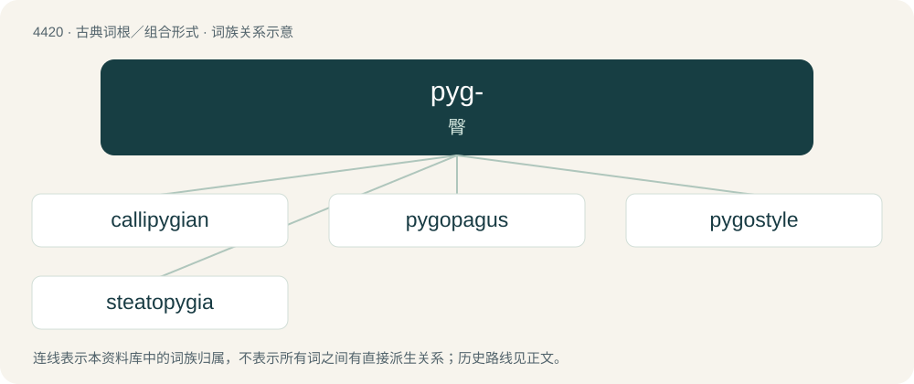

# 4420 · pyg- — 臀

[总目录](../00_总目录_按常用程度.md)

**类型**：古典词根／组合形式　｜　**来源语言**：古希腊语

## 核心含义与来源

- 核心含义：臀
- 英文含义：rump
- 词形：pyg-

**来源词形**：πυγή (pugḗ)

## 词族图

## 单词速览（常用到不常用）

| 单词 | 音标 | 释义 |
|---|---|---|
| [callipygian](#w-1) | 美 /ˌkæ.ləˈpɪ.d͡ʒi.ən/ | a. 健美臀部的,臀部线条优美的 |
| [pygopagus](#w-2) |  | \[医\] 臀部联胎 |
| [pygostyle](#w-3) | /ˈpaɪɡəstaɪl/ | 尾综骨 |
| [steatopygia](#w-4) | /,stiətəuˈpidʒiə/ | 臀部特别肥突(尤指妇女) |

## 逐词详解

### 1. callipygian

**词性**：形容词　｜　**音标**：美 /ˌkæ.ləˈpɪ.d͡ʒi.ən/

**中文释义**：a. 健美臀部的,臀部线条优美的

**英文义项**：Having beautifully shaped buttocks. / Specifically, describing a statue (often of a goddess such as Aphrodite) in a pose that shows off the figure's shapely buttocks.

**词源与演化**：

From Ancient Greek καλλίπυγος (kallípugos) + -ian, from κάλλος (kállos, “beauty”) + πυγή (pugḗ, “buttocks”).

**例句**：

> The quest for the callipygian ideal.

该用例对应义项：pertaining to or having finely developed buttocks

### 2. pygopagus

**词性**：名词

**中文释义**：\[医\] 臀部联胎

**英文义项**：A conjoined twin, or a pair of conjoined twins, exhibiting fusion of the sacrum.

**构词拆分**：pygo- + -pagus

**词源与演化**：

From pygo- + -pagus.

### 3. pygostyle

**词性**：名词　｜　**音标**：/ˈpaɪɡəstaɪl/

**中文释义**：尾综骨

**英文义项**：The plate supporting the tail-feathers in birds, formed from fused vertebrae.

**词源与演化**：

From English pygo- + Ancient Greek στῦλος (stûlos, “column”). By surface analysis, pygo- + -style.

### 4. steatopygia

**词性**：名词　｜　**音标**：/,stiətəuˈpidʒiə/

**中文释义**：臀部特别肥突(尤指妇女)

**英文义项**：An excessive accumulation of fat on the buttocks.

**构词拆分**：steato- + pygo- + -ia

**词源与演化**：

From steato- + pygo- + -ia.
