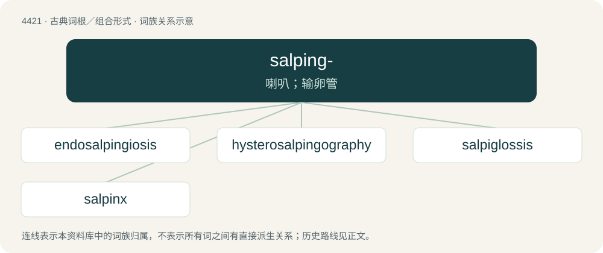

# 4421 · salping- — 喇叭；输卵管

[总目录](../00_总目录_按常用程度.md)

**类型**：古典词根／组合形式　｜　**来源语言**：古希腊语

## 核心含义与来源

- 核心含义：喇叭；输卵管
- 英文含义：trumpet
- 词形：salping-

**来源词形**：σάλπιγξ, σάλπιγγος (sálpinx, sálpingos)

## 词族图

## 单词速览（常用到不常用）

| 单词 | 音标 | 释义 |
|---|---|---|
| [endosalpingiosis](#w-1) |  | \[医\] 输卵管子宫内膜异位 |
| [hysterosalpingography](#w-2) | /,histərə,sælpiŋˈ^ɔ^rəfi/ | \[医\]子宫输卵管X线摄影术 |
| [salpiglossis](#w-3) | /.sælpiˈglɒsis/ | n. 蛾蝶花 |
| [salpinx](#w-4) | /ˈsæl.pɪŋks/ | n. 输卵管, 欧氏管 |

## 逐词详解

### 1. endosalpingiosis

**词性**：名词

**中文释义**：\[医\] 输卵管子宫内膜异位

**英文义项**：A condition in which Fallopian tube-like epithelium is found outside of the Fallopian tube.

### 2. hysterosalpingography

**词性**：名词　｜　**音标**：/,histərə,sælpiŋˈ^ɔ^rəfi/

**中文释义**：\[医\]子宫输卵管X线摄影术

**英文义项**：An X-ray test that uses contrast dye to examine the uterus and fallopian tubes, mainly to check their shape and whether the tubes are open, often as part of infertility evaluation.

**构词拆分**：hystero- + salpingo- + -graphy

**词源与演化**：

From hystero- + salpingo- + -graphy.

### 3. salpiglossis

**词性**：名词　｜　**音标**：/.sælpiˈglɒsis/

**中文释义**：n. 蛾蝶花

**英文义项**：Any of several plants, of the genus Salpiglossis, that have variegated, funnel-shaped blossoms in a variety of colors

**词源与演化**：

Genus name.

### 4. salpinx

**词性**：名词　｜　**音标**：/ˈsæl.pɪŋks/

**中文释义**：n. 输卵管, 欧氏管

**英文义项**：A Fallopian tube. / A Eustachian tube.

**词源与演化**：

Borrowed from New Latin salpinx.
