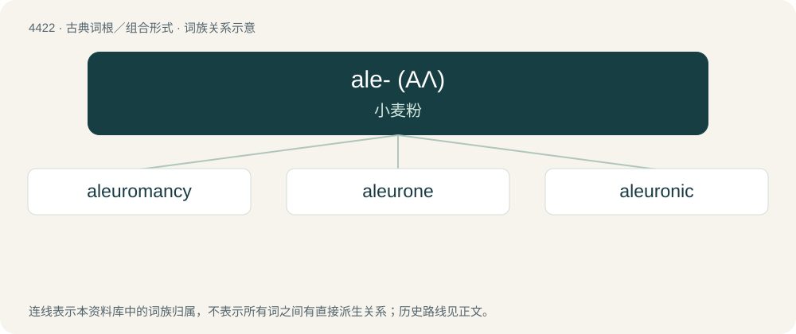

# 4422 · ale- (ΑΛ) — 小麦粉

[总目录](../00_总目录_按常用程度.md)

**类型**：古典词根／组合形式　｜　**来源语言**：古希腊语

## 核心含义与来源

- 核心含义：小麦粉
- 英文含义：wheat flour
- 词形：ale-

**来源词形**：ἀλέω, ἄλευρον (áleuron), ἀλείατα

## 词族图

## 单词速览（常用到不常用）

| 单词 | 音标 | 释义 |
|---|---|---|
| [aleuromancy](#w-1) |  | 【英文】divination using flour or related products such as dough or cakes and fortune cookies |
| [aleurone](#w-2) | /ˈæljəˌɹoʊn/ | n. \[植\] 糊粉(一种储藏于许多种子的胚、胚乳或外胚乳内的蛋白质物质) |
| [aleuronic](#w-3) | /,æljjəˈrɔnik/ | a. 糊粉的,籽朊粒 |

## 逐词详解

### 1. aleuromancy

**词性**：名词

**英文义项**：divination using flour or related products such as dough or cakes and fortune cookies

**构词拆分**：aleuro- (“wheat flour”) + -mancy (“divination”)

**词源与演化**：

From aleuro- (“wheat flour”) + -mancy (“divination”).

### 2. aleurone

**词性**：名词　｜　**音标**：/ˈæljəˌɹoʊn/

**中文释义**：n. \[植\] 糊粉(一种储藏于许多种子的胚、胚乳或外胚乳内的蛋白质物质)

**英文义项**：The protein content of the embryo, endosperm, or perisperm of cereals, in the form of minute particles. / The outer layer (and its major cell type and its specialized protein) of the endosperm.

**词源与演化**：

1865/70; from Ancient Greek ἄλευρον (áleuron, “flour, meal”).

### 3. aleuronic

**词性**：形容词　｜　**音标**：/,æljjəˈrɔnik/

**中文释义**：a. 糊粉的,籽朊粒

**英文义项**：Of or pertaining to aleurone.

**构词拆分**：aleurone + -ic

**词源与演化**：

From aleurone + -ic.
