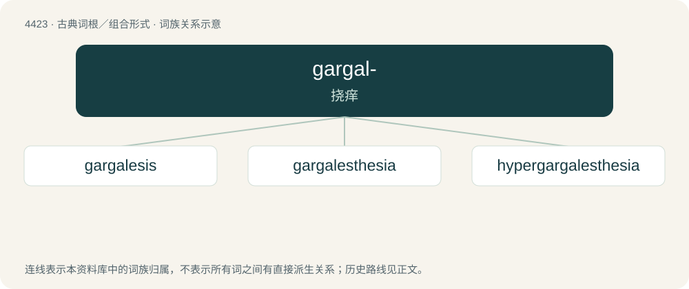

# 4423 · gargal- — 挠痒

[总目录](../00_总目录_按常用程度.md)

**类型**：古典词根／组合形式　｜　**来源语言**：古希腊语

## 核心含义与来源

- 核心含义：挠痒
- 英文含义：tickle
- 词形：gargal-

**来源词形**：γαργαλίζειν (gargalízein), γαργαλιζόμενον (gargalizómenon), γαργαλισμός (gargalismós)

## 词族图

## 单词速览（常用到不常用）

| 单词 | 音标 | 释义 |
|---|---|---|
| [gargalesis](#w-1) |  | 【英文】Heavy tickling often leading to laughter. |
| [gargalesthesia](#w-2) |  | \[医\] 撩感, 痒感 |
| [hypergargalesthesia](#w-3) |  | 【英文】An extreme sensitivity to tickling |

## 逐词详解

### 1. gargalesis

**词性**：名词

**英文义项**：Heavy tickling often leading to laughter.

**词源与演化**：

From Ancient Greek γαργαλίζω (gargalízō, “tickle”) + -esis.

### 2. gargalesthesia

**词性**：名词

**中文释义**：\[医\] 撩感, 痒感

**英文义项**：The sensation commonly associated with tickling.

**构词拆分**：Ancient Greek γαργαλίζω (gargalízō, “tickle”) + -esthesia

**词源与演化**：

From Ancient Greek γαργαλίζω (gargalízō, “tickle”) + -esthesia.

### 3. hypergargalesthesia

**词性**：名词

**英文义项**：An extreme sensitivity to tickling
