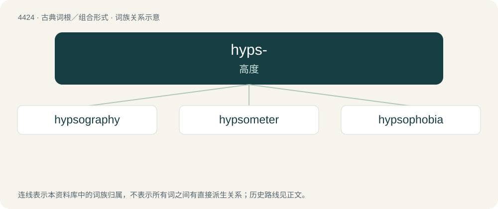

# 4424 · hyps- — 高度

[总目录](../00_总目录_按常用程度.md)

**类型**：古典词根／组合形式　｜　**来源语言**：古希腊语

## 核心含义与来源

- 核心含义：高度
- 英文含义：height
- 词形：hyps-

**来源词形**：ὕψι, ὕψιστος, ὕψος (húpsos), ὑψοῦ, ὑψόθεν

## 词族图

## 单词速览（常用到不常用）

| 单词 | 音标 | 释义 |
|---|---|---|
| [hypsography](#w-1) | /hipˈsɔ^rəfi/ | n. 地形测绘学, 测高法 |
| [hypsometer](#w-2) | /hipˈsɒmitə/ | n. 测高计；\[化\] 沸点测定器; 沸点测高器 |
| [hypsophobia](#w-3) | /,hipsəˈfəubiə/ | 居高恐怖 |

## 逐词详解

### 1. hypsography

**词性**：名词　｜　**音标**：/hipˈsɔ^rəfi/

**中文释义**：n. 地形测绘学, 测高法

**英文义项**：The data present in contour lines; measurement of altitude or depth versus area.

**构词拆分**：hypso- + -graphy

**词源与演化**：

From hypso- + -graphy.

### 2. hypsometer

**词性**：名词　｜　**音标**：/hipˈsɒmitə/

**中文释义**：n. 测高计；\[化\] 沸点测定器; 沸点测高器

**英文义项**：An instrument that measures altitude indirectly by measuring the boiling point of water (which varies with atmospheric pressure).

**构词拆分**：hypso- + -meter

**词源与演化**：

From hypso- + -meter.

### 3. hypsophobia

**词性**：名词　｜　**音标**：/,hipsəˈfəubiə/

**中文释义**：居高恐怖

**英文义项**：Fear of heights.

**构词拆分**：hypso- + -phobia

**词源与演化**：

From hypso- + -phobia.
