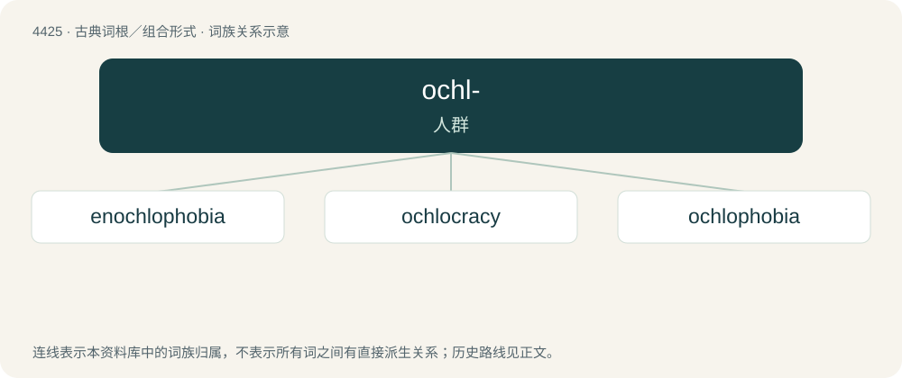

# 4425 · ochl- — 人群

[总目录](../00_总目录_按常用程度.md)

**类型**：古典词根／组合形式　｜　**来源语言**：古希腊语

## 核心含义与来源

- 核心含义：人群
- 英文含义：crowd, mob
- 词形：ochl-

**来源词形**：ὄχλος, ὄχλου (ókhlos, ókhlou)

## 词族图

## 单词速览（常用到不常用）

| 单词 | 音标 | 释义 |
|---|---|---|
| [enochlophobia](#w-1) |  | 【英文】Fear of crowds. |
| [ochlocracy](#w-2) | 英 /ɒkˈlɒk.ɹə.si/；美 /ɑkˈlɑ.kɹə.si/ | n. 暴民政治 |
| [ochlophobia](#w-3) | /,ɔkləˈfəubiə/ | n. \[心\]人群恐怖,恐群症 |

## 逐词详解

### 1. enochlophobia

**词性**：名词

**英文义项**：Fear of crowds.

### 2. ochlocracy

**词性**：名词　｜　**音标**：英 /ɒkˈlɒk.ɹə.si/；美 /ɑkˈlɑ.kɹə.si/

**中文释义**：n. 暴民政治

**英文义项**：Mob rule; government by the masses; mobocracy.

**构词拆分**：ochlo- + -cracy

**词源与演化**：

From Middle French ochlocratie, from Ancient Greek ὀχλοκρατία (okhlokratía), from ὄχλος (ókhlos, “multitude, crowd”) + κράτος (krátos, “power”). Equivalent to ochlo- + -cracy.

### 3. ochlophobia

**词性**：名词　｜　**音标**：/,ɔkləˈfəubiə/

**中文释义**：n. \[心\]人群恐怖,恐群症

**英文义项**：A phobia, or fear, of mob-like crowds, as opposed to simply open spaces like agoraphobia or large crowds as with enochlophobia.

**构词拆分**：ochlo- + -phobia

**词源与演化**：

From Ancient Greek ὄχλος (ókhlos, “crowd”) + -phobia, equivalent to ochlo- + -phobia.
