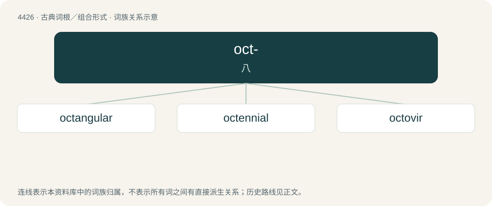

# 4426 · oct- — 八

[总目录](../00_总目录_按常用程度.md)

**类型**：古典词根／组合形式　｜　**来源语言**：拉丁语

## 核心含义与来源

- 核心含义：八
- 英文含义：eight
- 词形：oct-

**来源词形**：octō

## 词族图

## 单词速览（常用到不常用）

| 单词 | 音标 | 释义 |
|---|---|---|
| [octangular](#w-1) | /ɑkˈtæŋ.ɡjə.lə(ɹ)/ | a. 八边形的,八角形的 |
| [octennial](#w-2) | /ɔkˈteinjəl, -niəl/ | a. 每八年的, 延续八年的 |
| [octovir](#w-3) |  | 【英文】Any member of a group of eight officials. |

## 逐词详解

### 1. octangular

**词性**：形容词　｜　**音标**：/ɑkˈtæŋ.ɡjə.lə(ɹ)/

**中文释义**：a. 八边形的,八角形的

**英文义项**：Octagonal, with eight angles.

**词源与演化**：

From Classical Latin octangulus + -ar. Compare French octangulaire. By surface analysis, oct- + -angular.

### 2. octennial

**词性**：形容词　｜　**音标**：/ɔkˈteinjəl, -niəl/

**中文释义**：a. 每八年的, 延续八年的

**英文义项**：Occurring every eight years. / Lasting or taking eight years.

**构词拆分**：oct- + -ennial

**词源与演化**：

From oct- + -ennial.

### 3. octovir

**词性**：名词

**英文义项**：Any member of a group of eight officials.

**词源与演化**：

From Latin octōvir.
