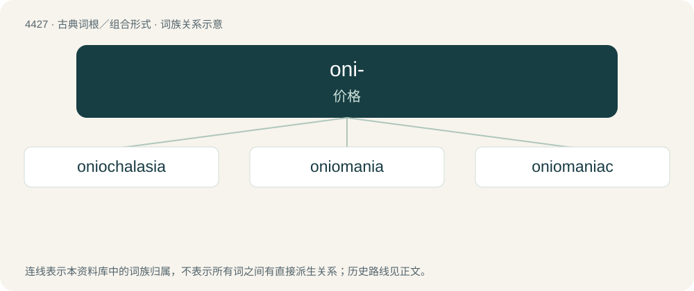

# 4427 · oni- — 价格

[总目录](../00_总目录_按常用程度.md)

**类型**：古典词根／组合形式　｜　**来源语言**：古希腊语

## 核心含义与来源

- 核心含义：价格
- 英文含义：price
- 词形：oni-

**来源词形**：ὦνος (ônos), ὤνιος (ṓnios)

## 词族图

## 单词速览（常用到不常用）

| 单词 | 音标 | 释义 |
|---|---|---|
| [oniochalasia](#w-1) | 英 /ˌəʊnɪ.əʊkəˈleɪzɪ.ə/；美 /ˌoʊni.oʊkəˈleɪʒə/ | 【英文】The act of purchasing objects as a form of mental relaxation. |
| [oniomania](#w-2) | 英 /ˌəʊnɪ.əʊˈmeɪnɪ.ə/；美 /ˌoʊni.oʊˈmeɪni.ə/ | n. 购买癖,购买狂 |
| [oniomaniac](#w-3) | 英 /ˌəʊnɪ.əʊˈmeɪnɪ.ak/；美 /ˌoʊni.oʊˈmeɪni.æk/ | 【英文】A sufferer from oniomania. |

## 逐词详解

### 1. oniochalasia

**词性**：名词　｜　**音标**：英 /ˌəʊnɪ.əʊkəˈleɪzɪ.ə/；美 /ˌoʊni.oʊkəˈleɪʒə/

**英文义项**：The act of purchasing objects as a form of mental relaxation.

**词源与演化**：

From Ancient Greek ὤνιος (ṓnios, “for sale”) + χαλαστικός (khalastikós, “relaxing”).

### 2. oniomania

**词性**：名词　｜　**音标**：英 /ˌəʊnɪ.əʊˈmeɪnɪ.ə/；美 /ˌoʊni.oʊˈmeɪni.ə/

**中文释义**：n. 购买癖,购买狂

**英文义项**：An abnormal impulse to buy things, or a condition characterised by such impulses.

**词源与演化**：

Internationalism, from Ancient Greek ὤνιος (ṓnios, “for sale”) + -mania, after German Oniomanie.

### 3. oniomaniac

**词性**：名词　｜　**音标**：英 /ˌəʊnɪ.əʊˈmeɪnɪ.ak/；美 /ˌoʊni.oʊˈmeɪni.æk/

**英文义项**：A sufferer from oniomania.

**词源与演化**：

From oniomania. By surface analysis, Ancient Greek ὤνιος (ṓnios, “for sale”) + -maniac.
