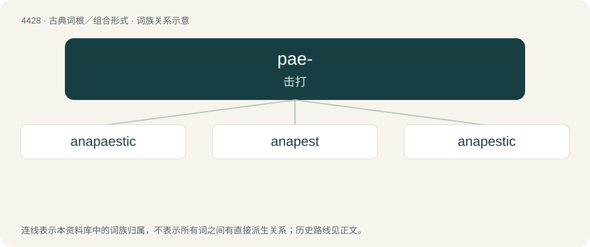

# 4428 · pae- — 击打

[总目录](../00_总目录_按常用程度.md)

**类型**：古典词根／组合形式　｜　**来源语言**：古希腊语

## 核心含义与来源

- 核心含义：击打
- 英文含义：strike
- 词形：pae-

**来源词形**：παίειν (paíein), (paistos)

## 词族图

## 单词速览（常用到不常用）

| 单词 | 音标 | 释义 |
|---|---|---|
| [anapaestic](#w-1) | /,ænəˈpiːstik/ | a. 抑抑扬格的 |
| [anapest](#w-2) | /ˈæ.nə.piːst/ | n. &lt;美&gt;抑抑扬格, 短短长格 |
| [anapestic](#w-3) | /ˌæ.nəˈpiː.stɪk/ | a. 抑抑扬格的；短短长格的 |

## 逐词详解

### 1. anapaestic

**词性**：形容词　｜　**音标**：/,ænəˈpiːstik/

**中文释义**：a. 抑抑扬格的

**英文义项**：British standard spelling of anapestic.

**词源与演化**：

From Latin anapaesticus. By surface analysis, anapaest + -ic.

### 2. anapest

**词性**：名词　｜　**音标**：/ˈæ.nə.piːst/

**中文释义**：n. &lt;美&gt;抑抑扬格, 短短长格

**英文义项**：In qualitative metre, a foot with two unstressed syllables followed by a stressed final syllable. / In quantitative metre, a foot with two short syllables followed by a long final syllable.

**词源与演化**：

From Latin anapaestus, from Ancient Greek ἀνάπαιστος (anápaistos, “struck back, reversed \[relative to dactyl\]”), from ἀνά (aná, “back”) + παίω (paíō, “to strike”).

### 3. anapestic

**词性**：形容词　｜　**音标**：/ˌæ.nəˈpiː.stɪk/

**中文释义**：a. 抑抑扬格的；短短长格的

**英文义项**：Of, relating to, or composed of, anapests. / Of, or relating to, one of the distinct beats in a (human) heartbeat pattern.

**词源与演化**：

From Latin anapaesticus. By surface analysis, anapest + -ic.

## 其他候选词

- anapaest
