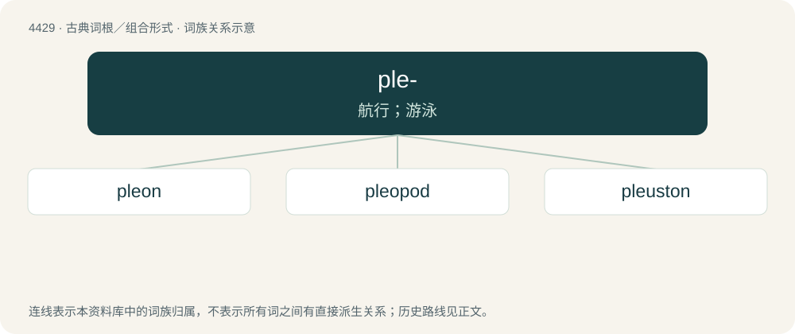

# 4429 · ple- — 航行；游泳

[总目录](../00_总目录_按常用程度.md)

**类型**：古典词根／组合形式　｜　**来源语言**：古希腊语

## 核心含义与来源

- 核心含义：航行；游泳
- 英文含义：sail, swim
- 词形：ple-

**来源词形**：πλεῖν (pleîn), πλεῦσις (pleûsis), πλόος

## 词族图

## 单词速览（常用到不常用）

| 单词 | 音标 | 释义 |
|---|---|---|
| [pleon](#w-1) | /ˈpliːɒn/ | (甲壳类的)腹部 |
| [pleopod](#w-2) | /ˈpliːəˌpɒd/ | n. 腹足 |
| [pleuston](#w-3) | /ˈpluːstən/ | n. 水漂生物 |

## 逐词详解

### 1. pleon

**词性**：名词　｜　**音标**：/ˈpliːɒn/

**中文释义**：(甲壳类的)腹部

**英文义项**：The abdomen of a crustacean.

**词源与演化**：

Borrowed from New Latin, from Ancient Greek πλέων (pléōn), present participle of πλεῖν (pleîn, “to sail”); from the fact that it bears the swimming limbs. Alternatively, perhaps in the sense of being longer or extended.

### 2. pleopod

**词性**：名词　｜　**音标**：/ˈpliːəˌpɒd/

**中文释义**：n. 腹足

**英文义项**：One of the abdominal legs of a crustacean.

**构词拆分**：From pleon (“the abdomen of a crustacean”) + -pod (“foot”).

**词源与演化**：

From pleon (“the abdomen of a crustacean”) + -pod (“foot”).

**例句**：

> In decapods such as lobsters, pleopods are legs mainly used for swimming but sometimes used for brooding eggs or catching food. In some species certain pleopods of an animal may have been adapted to special functions such as reproduction.

该用例对应义项：One of the abdominal legs of a crustacean.

### 3. pleuston

**词性**：名词　｜　**音标**：/ˈpluːstən/

**中文释义**：n. 水漂生物

**英文义项**：The organisms that live floating at the surface of water. / Plants that live floating at the surface of water.

**词源与演化**：

From Ancient Greek πλεῦσις (pleûsis, “sailing”), from πλέω (pléō) + -on. The -t- is on analogy with the coordinate terms.
