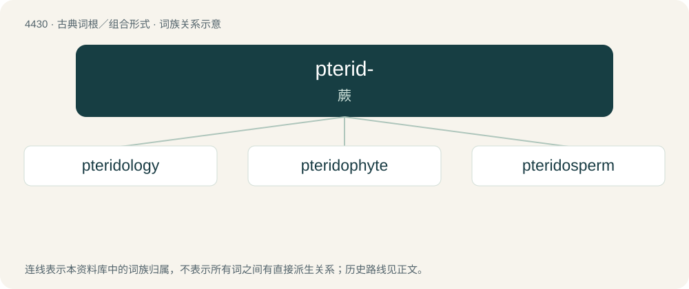

# 4430 · pterid- — 蕨

[总目录](../00_总目录_按常用程度.md)

**类型**：古典词根／组合形式　｜　**来源语言**：古希腊语

## 核心含义与来源

- 核心含义：蕨
- 英文含义：fern
- 词形：pterid-

**来源词形**：πτερίς, πτερίδος (pterís, pterídos)

## 词族图

## 单词速览（常用到不常用）

| 单词 | 音标 | 释义 |
|---|---|---|
| [pteridology](#w-1) | /.teriˈdɒlədʒi/ | n. 蕨类植物学 |
| [pteridophyte](#w-2) | 英 /tɪˈɹɪdəˌfaɪt/；美 /təˈɹɪdəˌfaɪt/ | n. 蕨类植物；\[医\] 蕨类植物 |
| [pteridosperm](#w-3) | /ˈ(p)teridəuspəːm/ | n. \[植\]种子蕨 |

## 逐词详解

### 1. pteridology

**词性**：名词　｜　**音标**：/.teriˈdɒlədʒi/

**中文释义**：n. 蕨类植物学

**英文义项**：The scientific study of ferns and other pteridophytes.

**构词拆分**：pterido- + -logy

**词源与演化**：

From pterido- + -logy.

### 2. pteridophyte

**词性**：名词　｜　**音标**：英 /tɪˈɹɪdəˌfaɪt/；美 /təˈɹɪdəˌfaɪt/

**中文释义**：n. 蕨类植物；\[医\] 蕨类植物

**英文义项**：Any plant of the division Pteridophyta, of simple vascular plants that reproduce via spores rather than seeds and that alternate generations of diploid (sporophyte) and haploid (gametophyte or prothallus) forms, the diploid generally being larger and more conspicuous.

**构词拆分**：pterido- (“fern”) + -phyte (“plant”)

**词源与演化**：

From pterido- (“fern”) + -phyte (“plant”).

**例句**：

> Ferns, lycopods, and scouring rushes are all pteridophytes.

该用例对应义项：Any plant of the division Pteridophyta, of simple vascular plants that reproduce via spores rather than seeds and that alternate generations of diploid (sporophyte) and haploid (gametophyte or prothallus) forms, the diploid generally being larger and more conspicuous.

### 3. pteridosperm

**词性**：名词　｜　**音标**：/ˈ(p)teridəuspəːm/

**中文释义**：n. \[植\]种子蕨

**英文义项**：Any of various extinct gymnosperms, of the division Pteridospermatophyta, resembling ferns, but producing seeds instead of spores

**词源与演化**：

By surface analysis, pterido- + sperm.
