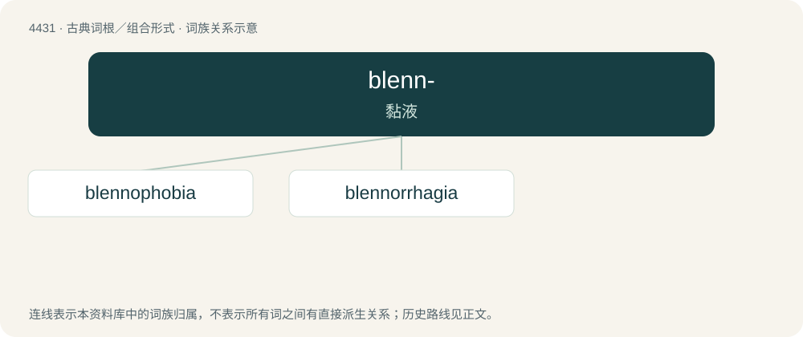

# 4431 · blenn- — 黏液

[总目录](../00_总目录_按常用程度.md)

**类型**：古典词根／组合形式　｜　**来源语言**：古希腊语

## 核心含义与来源

- 核心含义：黏液
- 英文含义：slime
- 词形：blenn-

**来源词形**：βλέννος (blénnos)

## 词族图

## 单词速览（常用到不常用）

| 单词 | 音标 | 释义 |
|---|---|---|
| [blennophobia](#w-1) |  | 【英文】The irrational fear of slime. |
| [blennorrhagia](#w-2) | /,blenəˈreidʒiə/ | 粘液溢出, 淋病 |

## 逐词详解

### 1. blennophobia

**词性**：名词

**英文义项**：The irrational fear of slime.

**词源与演化**：

From Ancient Greek βλέννος (blénnos, alternative form of βλέννα "mucus, slime") + -phobia, from Ancient Greek φόβος (phóbos, “fear”).

### 2. blennorrhagia

**词性**：名词　｜　**音标**：/,blenəˈreidʒiə/

**中文释义**：粘液溢出, 淋病

**英文义项**：Excessive blennorrhea, or mucous discharge, especially as seen in gonorrhea.

**构词拆分**：blenno- + -rrhagia

**词源与演化**：

From blenno- + -rrhagia, New Latin combining forms based on Ancient Greek roots.

## 其他候选词

- blennadenitis
- blennosperma
