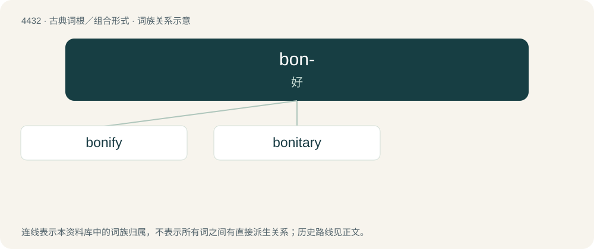

# 4432 · bon- — 好

[总目录](../00_总目录_按常用程度.md)

**类型**：古典词根／组合形式　｜　**来源语言**：拉丁语

## 核心含义与来源

- 核心含义：好
- 英文含义：good
- 词形：bon-

**来源词形**：bonus

## 词族图

## 单词速览（常用到不常用）

| 单词 | 音标 | 释义 |
|---|---|---|
| [bonify](#w-1) | /ˈbəʊnɪfaɪ/ | 【英文】To convert into―or make―good; to improve. |
| [bonitary](#w-2) |  | \[法\] 无所有权而有使用权的 |

## 逐词详解

### 1. bonify

**词性**：动词　｜　**音标**：/ˈbəʊnɪfaɪ/

**英文义项**：To convert into―or make―good; to improve. / To remit or reduce a price, typically in order to compensate for a tax for fee.

**词源与演化**：

From French bonifier.

### 2. bonitary

**词性**：形容词

**中文释义**：\[法\] 无所有权而有使用权的

**英文义项**：Beneficial, as opposed to statutory or civil.

**用法示例／搭配（非完整句）**：

> bonitary dominion of land

该用例对应义项：Beneficial, as opposed to statutory or civil.
