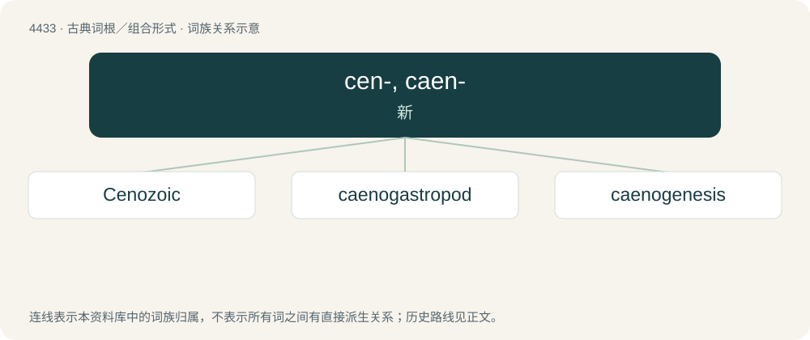

# 4433 · cen-, caen- — 新

[总目录](../00_总目录_按常用程度.md)

**类型**：古典词根／组合形式　｜　**来源语言**：古希腊语

## 核心含义与来源

- 核心含义：新
- 英文含义：new
- 词形：cen-, caen-

**来源词形**：καινός (kainós)

## 词族图

## 单词速览（常用到不常用）

| 单词 | 音标 | 释义 |
|---|---|---|
| [Cenozoic](#w-1) | 英 /ˌkeɪnəʊˈzəʊɪk/；美 /ˌkɛnɵˈzoʊɪk/ | n. 新生代, 新生界；a. 新生代的, 新生界的 |
| [caenogastropod](#w-2) |  | 【英文】Any gastropod of the subclass Caenogastropoda. |
| [caenogenesis](#w-3) | /ˈsiːnəˈdʒenisis/ | n. \[生物\]新性发生 |

## 逐词详解

### 1. Cenozoic

**词性**：形容词　｜　**音标**：英 /ˌkeɪnəʊˈzəʊɪk/；美 /ˌkɛnɵˈzoʊɪk/

**中文释义**：n. 新生代, 新生界；a. 新生代的, 新生界的

**英文义项**：Of or pertaining to the Cenozoic era.

**构词拆分**：ceno- + -zoic

**词源与演化**：

From ceno- + -zoic; from Ancient Greek καινός (kainós, “new”) + ζωή (zōḗ, “life”).

### 2. caenogastropod

**词性**：名词

**英文义项**：Any gastropod of the subclass Caenogastropoda.

**词源与演化**：

Borrowed from translingual Caenogastropoda. By surface analysis, Ancient Greek καινός (kainós, “new”) + gastropod.

### 3. caenogenesis

**词性**：名词　｜　**音标**：/ˈsiːnəˈdʒenisis/

**中文释义**：n. \[生物\]新性发生

**英文义项**：The embryotic development of structures or characteristics not present in the species before.

**词源与演化**：

From Ancient Greek καινός (kainós, “new”) + English -genesis. First attested in 1909.
