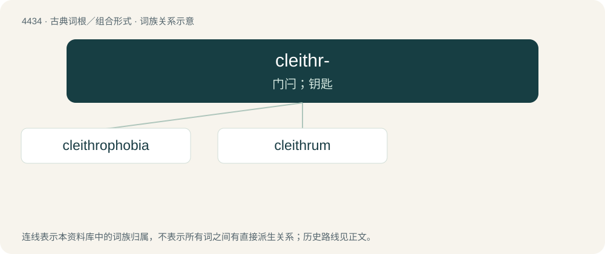

# 4434 · cleithr- — 门闩；钥匙

[总目录](../00_总目录_按常用程度.md)

**类型**：古典词根／组合形式　｜　**来源语言**：古希腊语

## 核心含义与来源

- 核心含义：门闩；钥匙
- 英文含义：bar, key
- 词形：cleithr-

**来源词形**：κλεῖθρον (kleîthron)

## 词族图

## 单词速览（常用到不常用）

| 单词 | 音标 | 释义 |
|---|---|---|
| [cleithrophobia](#w-1) | /,klaiθrɔˈfəubiə/ | (=claustrophobia, clithro-phobia)禁闭恐怖 |
| [cleithrum](#w-2) | /ˈklaiθrəm/ | 匙骨 |

## 逐词详解

### 1. cleithrophobia

**词性**：名词　｜　**音标**：/,klaiθrɔˈfəubiə/

**中文释义**：(=claustrophobia, clithro-phobia)禁闭恐怖

**英文义项**：fear of being trapped

**构词拆分**：Ancient Greek κλεῖθρον (kleîthron, “bar for closing a door”) + -phobia

**词源与演化**：

From Ancient Greek κλεῖθρον (kleîthron, “bar for closing a door”) + -phobia.

### 2. cleithrum

**词性**：名词　｜　**音标**：/ˈklaiθrəm/

**中文释义**：匙骨

**英文义项**：A large bone in fishes, which extends upward from the base of the pectoral fin and anchors to the cranium above the gills, forming the posterior edge of the gill chamber.

**词源与演化**：

From Ancient Greek κλεῖθρον (kleîthron).

## 其他候选词

- Clathrus
