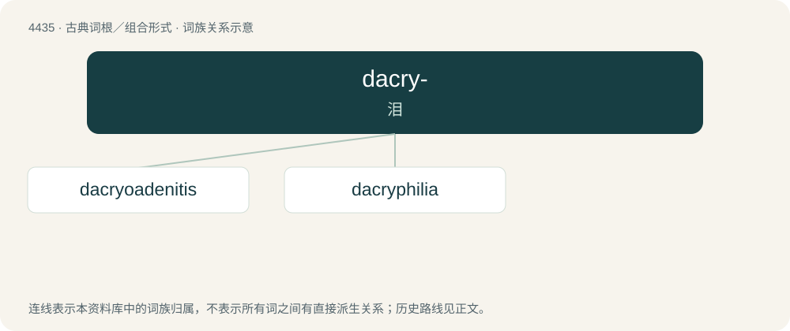

# 4435 · dacry- — 泪

[总目录](../00_总目录_按常用程度.md)

**类型**：古典词根／组合形式　｜　**来源语言**：古希腊语

## 核心含义与来源

- 核心含义：泪
- 英文含义：tear
- 词形：dacry-

**来源词形**：δάκρυον, δακρύειν, δάκρυμα (dákruma)

## 词族图

## 单词速览（常用到不常用）

| 单词 | 音标 | 释义 |
|---|---|---|
| [dacryoadenitis](#w-1) |  | \[医\] 泪腺炎 |
| [dacryphilia](#w-2) | 英 /ˌdækɹɪˈfɪlɪə/ | 【英文】A paraphilia in which one is aroused by tears or sobbing. |

## 逐词详解

### 1. dacryoadenitis

**词性**：名词

**中文释义**：\[医\] 泪腺炎

**英文义项**：inflammation of the lacrimal glands

**构词拆分**：dacryo- + adenitis

**词源与演化**：

From dacryo- + adenitis.

### 2. dacryphilia

**词性**：名词　｜　**音标**：英 /ˌdækɹɪˈfɪlɪə/

**英文义项**：A paraphilia in which one is aroused by tears or sobbing.

**构词拆分**：dacry- + -philia

**词源与演化**：

From Ancient Greek δάκρυ (dákru, “tear”) and φίλος (phílos, “loving”) (or dacry- + -philia).
