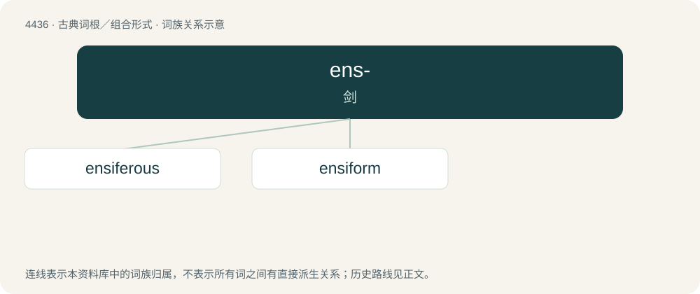

# 4436 · ens- — 剑

[总目录](../00_总目录_按常用程度.md)

**类型**：古典词根／组合形式　｜　**来源语言**：拉丁语

## 核心含义与来源

- 核心含义：剑
- 英文含义：sword
- 词形：ens-

**来源词形**：ensis

## 词族图

## 单词速览（常用到不常用）

| 单词 | 音标 | 释义 |
|---|---|---|
| [ensiferous](#w-1) |  | 【英文】sword-bearing. |
| [ensiform](#w-2) | 美 /ˈɛnsəˌfɔɹm/ | a. 剑形的；\[医\] 剑形的 |

## 逐词详解

### 1. ensiferous

**词性**：形容词

**英文义项**：sword-bearing.

**构词拆分**：ensifer + -ous

**词源与演化**：

From ensifer + -ous.

### 2. ensiform

**词性**：形容词　｜　**音标**：美 /ˈɛnsəˌfɔɹm/

**中文释义**：a. 剑形的；\[医\] 剑形的

**英文义项**：shaped like a sword blade

**词源与演化**：

From Latin ensis (“sword”) + -form.

**例句**：

> The iris has an ensiform leaf.

该用例对应义项：shaped like a sword blade
