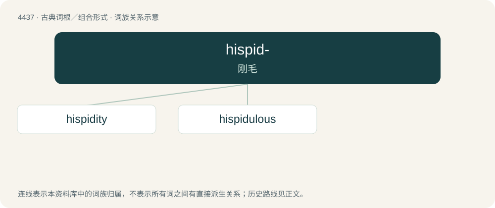

# 4437 · hispid- — 刚毛

[总目录](../00_总目录_按常用程度.md)

**类型**：古典词根／组合形式　｜　**来源语言**：拉丁语

## 核心含义与来源

- 核心含义：刚毛
- 英文含义：bristly
- 词形：hispid-

**来源词形**：hispidus

## 词族图

## 单词速览（常用到不常用）

| 单词 | 音标 | 释义 |
|---|---|---|
| [hispidity](#w-1) |  | 【英文】The quality of being hispid. |
| [hispidulous](#w-2) | /hisˈpidjuləs/ | a. \[生\]具短硬毛的 |

## 逐词详解

### 1. hispidity

**词性**：名词

**英文义项**：The quality of being hispid.

**构词拆分**：hispid + -ity

**词源与演化**：

From hispid + -ity.

### 2. hispidulous

**词性**：形容词　｜　**音标**：/hisˈpidjuləs/

**中文释义**：a. \[生\]具短硬毛的

**英文义项**：Minutely hispid; having tiny hairs.

**词源与演化**：

Diminutive of hispid. From Latin hispidul(us) + -ous. By surface analysis, hispid + -ule + -ous.
