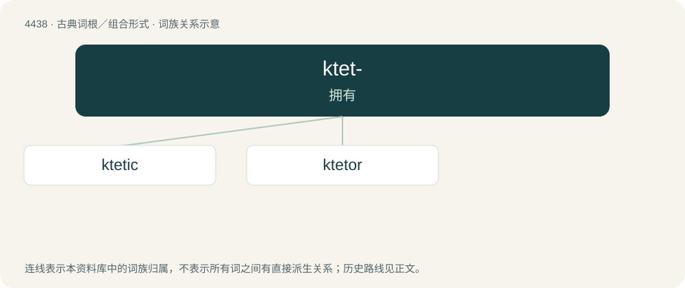

# 4438 · ktet- — 拥有

[总目录](../00_总目录_按常用程度.md)

**类型**：古典词根／组合形式　｜　**来源语言**：古希腊语

## 核心含义与来源

- 核心含义：拥有
- 英文含义：possession, ownership
- 词形：ktet-

**来源词形**：κτητικός (ktētikós), κτήτωρ (ktḗtōr)

## 词族图

## 单词速览（常用到不常用）

| 单词 | 音标 | 释义 |
|---|---|---|
| [ktetic](#w-1) |  | 【英文】possessive |
| [ktetor](#w-2) |  | 【英文】One who funds the building or reconstruction of an Eastern Orthodox church or monastery. |

## 逐词详解

### 1. ktetic

**词性**：形容词

**英文义项**：possessive

**词源与演化**：

From Ancient Greek κτητικός (ktētikós, “possessive”).

### 2. ktetor

**词性**：名词

**英文义项**：One who funds the building or reconstruction of an Eastern Orthodox church or monastery.

**词源与演化**：

From Ancient Greek κτήτωρ (ktḗtōr). The alternative form ktitor likely came via a Slavic intermediary such as Macedonian ктитор (ktitor) or Serbo-Croatian ktitor.
