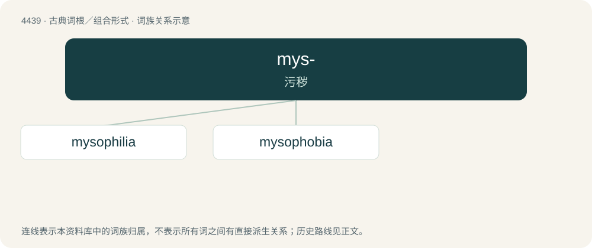

# 4439 · mys- — 污秽

[总目录](../00_总目录_按常用程度.md)

**类型**：古典词根／组合形式　｜　**来源语言**：古希腊语

## 核心含义与来源

- 核心含义：污秽
- 英文含义：uncleanness
- 词形：mys-

**来源词形**：μύσος (músos)

## 词族图

## 单词速览（常用到不常用）

| 单词 | 音标 | 释义 |
|---|---|---|
| [mysophilia](#w-1) | 英 /ˌmaɪsəʊ̆ˈfɪlɪə/ | n. \[医\]恋秽癖,嗜污癖 |
| [mysophobia](#w-2) | /,maisəˈfəubiə/ | n. \[心\]不洁恐怖(指病态的洁癖) |

## 逐词详解

### 1. mysophilia

**词性**：名词　｜　**音标**：英 /ˌmaɪsəʊ̆ˈfɪlɪə/

**中文释义**：n. \[医\]恋秽癖,嗜污癖

**英文义项**：A sexual dependency on something soiled or filthy, usually a kind of undergarment after use.

**构词拆分**：myso- + -philia

**词源与演化**：

From myso- + -philia.

### 2. mysophobia

**词性**：名词　｜　**音标**：/,maisəˈfəubiə/

**中文释义**：n. \[心\]不洁恐怖(指病态的洁癖)

**英文义项**：An abnormal fear of uncleanliness, dirt, or contamination.

**构词拆分**：myso- + -phobia

**词源与演化**：

From myso- + -phobia.
