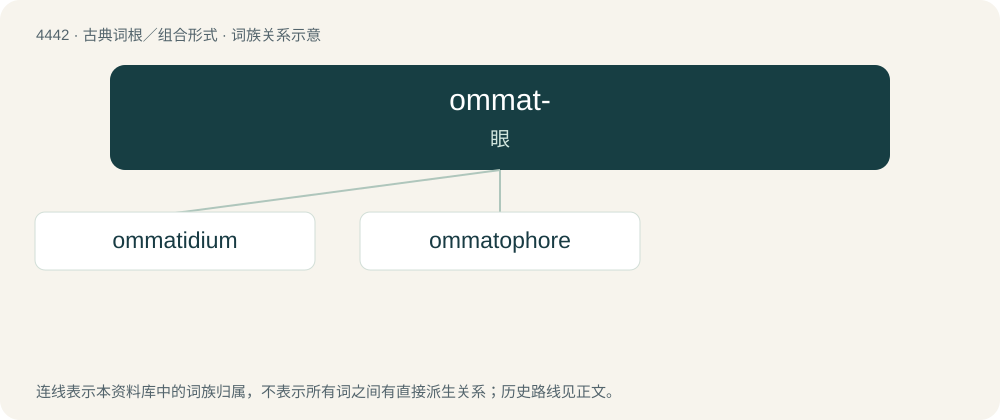

# 4441 · ommat- — 眼

[总目录](../00_总目录_按常用程度.md)

**类型**：古典词根／组合形式　｜　**来源语言**：古希腊语

## 核心含义与来源

- 核心含义：眼
- 英文含义：eye
- 词形：ommat-

**来源词形**：ὁράω, ὦμμαι, ὄμμα, ὄμματος (ómma, ómmatos)

## 词族图

## 单词速览（常用到不常用）

| 单词 | 音标 | 释义 |
|---|---|---|
| [ommatidium](#w-1) | 英 /ɒməˈtɪdɪəm/ | n. \[动\]小眼 |
| [ommatophore](#w-2) | 英 /ˈɒ.mə.tə.fɔː/；美 /əˈmæ.tə.fɔɹ/ | n. \[动\]担眼器 |

## 逐词详解

### 1. ommatidium

**词性**：名词　｜　**音标**：英 /ɒməˈtɪdɪəm/

**中文释义**：n. \[动\]小眼

**英文义项**：One of the conical substructures which make up the eyes of invertebrates with compound eyes.

**词源与演化**：

From Ancient Greek ὀμματίδιον (ommatídion, “little eye”), equivalent to ὄμμα (ómma, stem ὄμματ-) + -idium.

### 2. ommatophore

**词性**：名词　｜　**音标**：英 /ˈɒ.mə.tə.fɔː/；美 /əˈmæ.tə.fɔɹ/

**中文释义**：n. \[动\]担眼器

**英文义项**：An eyestalk.

**词源与演化**：

From the stem form of Ancient Greek ὄμμα (ómma, “eye”) + -phore.
